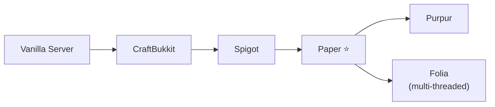
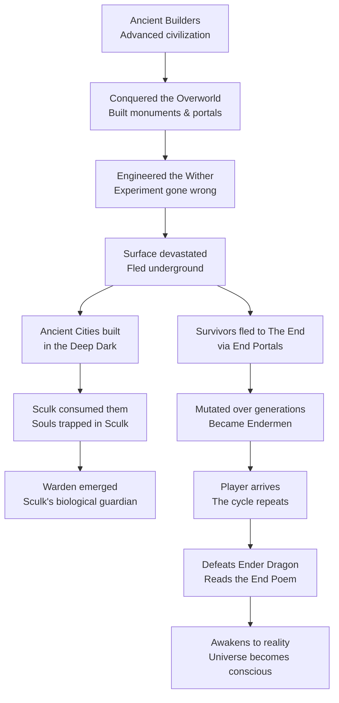

# 🟩 The Complete Minecraft Java Edition Encyclopedia

> [!NOTE]
> Comprehensive Java Edition knowledge base compiled from Minecraft Wiki, official changelogs, community wikis, mod repositories, speedrunning leaderboards, YouTube/Twitch creators, and more.
> **Current as of: October 24, 2024.**
> This document covers **Java Edition exclusively**.

---

## Table of Contents (Organized by 5 Core Categories)

### 🧭 Category I: Learn Minecraft
*Getting started · Progression · Game modes · Survival guides*
- [1. Game Overview, Getting Started & Game Modes](#1-game-overview--history)
- [11. Progression, Combat Systems & Gear Tiers](#11-combat-weapons--progression)
- [12. Survival Guides: Farming, Food & Hunger Dynamics](#12-farming--food)

### 🌍 Category II: Explore the World
*Biomes · Mobs · Structures · Dimensions · Lore*
- [3. Dimensions & Biomes (Caves & Cliffs)](#3-dimensions--biomes)
- [4. All Mobs & Creature Bestiary (Spawn spheres, Caps, Warden)](#4-all-mobs)
- [10. Generated Structures & Dungeons (Trial Chambers, Ancient Cities)](#10-generated-structures)
- [18. Lore, Story & Environmental Mysteries (End Poem, Builders)](#18-lore--story)

### ⚙️ Category III: Build & Engineer
*Redstone · Automatic farms · Enchantments · Brewing · Commands*
- [9. Redstone Engineering & Logic Systems (Quasi-connectivity, Comparators)](#9-redstone-engineering)
- [6. Automatic Farms & The 1.21 Crafter](#6-crafting-system)
- [5. Blocks, Items & Material Properties](#5-blocks--items)
- [7. Enchantment Laboratory & Anvil Binary Trees (42 Enchantments, God Gear)](#7-enchantments)
- [8. Potions, Alchemy & Brewing Stand (16 Potions, Ominous Effects)](#8-potions--brewing)
- [15. Commands, Functions & Modern Data Components (/execute, Syntax)](#15-commands--command-blocks)

### 🎨 Category IV: Customize & Play
*Mods · Modpacks · Shaders · Resource packs · Servers · Speedrunning*
- [13. The Modding Ecosystem & Performance Stacks (Fabric, NeoForge, Sodium)](#13-the-modding-ecosystem)
- [14. Resource Packs, Shaders & Data Packs (pack.mcmeta, GLSL)](#14-resource-packs-shaders--data-packs)
- [16. Multiplayer, Dedicated Servers & Networking (25565, 20 TPS)](#16-multiplayer--server-ecosystem)
- [17. Speedrunning Categories & World Records (Any% RSG, SSG)](#17-speedrunning)

### 📰 Category V: Versions & News
*Version history · Current releases · Snapshots · Upcoming changes · Creators*
- [2. Version History & Official Release Timeline (1.0 to 1.21.3)](#2-version-history--the-new-numbering-system)
- [19. Community, Content Creators & Events (Hermitcraft, 1T Views)](#19-community--content-creators)
- [20. Official Version Timeline & Snapshots Reference (Pale Garden 24w40a+)](#20-complete-update-timeline-2024oct-2026)

---

## 1. Game Overview & History

**Minecraft** is a sandbox survival/creative game originally created by **Markus "Notch" Persson** in **2009**, developed by **Mojang Studios** (acquired by **Microsoft** in 2014 for \$2.5 billion). The **Java Edition** is the original PC version, written in Java, and remains the definitive platform for modding, technical gameplay, and competitive communities.

### Java Edition Exclusives (vs Bedrock)
- **Hardcore Mode** — one life, world deletes on death (Bedrock received Hardcore parity in 1.21.2)
- **Spectator Mode** — fly through blocks, observe mobs' POV
- **Advancements system** (vs Bedrock's "Achievements")
- **Free, open-source modding** via Forge / Fabric / NeoForge
- **Open community servers** — connect via any IP address (port 25565 default)
- **Quasi-connectivity** in Redstone (pistons powered from above/diagonally)
- **Complex cooldown-based combat** with sweep attacks
- **Dual-wielding** shields, torches, maps in off-hand
- **Access to every past version** via the launcher (Alpha, Beta, all snapshots)
- **5 distinct End sub-biomes** (Bedrock has 1)
- **Data packs & custom world generation**

### Core Gameplay Pillars
- **Mining:** Dig deep to find ores (Coal → Iron → Copper → Gold → Diamond → Netherite)
- **Crafting:** Combine materials on a 3×3 grid into tools, weapons, armor, machines
- **Building:** Place any of 800+ block types to construct anything imaginable
- **Survival:** Manage health, hunger, fight hostile mobs, progress through dimensions
- **Exploration:** Discover biomes, structures, and loot across three dimensions
- **Automation:** Use Redstone circuits, Hoppers, and the Crafter for automated systems
- **Creative Mode:** Unlimited blocks, flight, no health — pure sandbox
- **Adventure Mode:** Locked interactions for custom map makers

---

## 2. Version History & The New Release Model

### The Official Release Cadence Shift (September 9, 2024 Announcement)
On September 9, 2024, Mojang Studios officially announced a major evolution in how Minecraft is developed and updated:
- **Abandoning the Single Annual Update:** Mojang retired the tradition of releasing one massive summer update per year.
- **Frequent Themed "Game Drops":** Content is now delivered through multiple smaller, focused Game Drops throughout the calendar year to introduce features as soon as they are polished.
- **Active Snapshot & Preview Testing:** Regular weekly Java Edition snapshots (`YYwWWa` notation) and Bedrock Previews test features directly with the community.
- **Java Edition Versioning Parity:** Java Edition continues using canonical `1.x` release numbering (e.g. 1.21, 1.21.2, 1.21.3) rather than a year-based naming scheme.

### Verified Major Java Edition Releases (1.0 to 1.21.3)
| Version | Official Name / Drop | Release Date | Key Canonical Features |
|---------|----------------------|--------------|------------------------|
| **1.21.2 / 1.21.3** | *Bundles of Bravery* | October 22, 2024 | The Bundle (1 Leather + 1 String, 64 items), 16 dye colors, Bedrock Hardcore parity |
| **1.21** | *Tricky Trials* | June 13, 2024 | Trial Chambers, The Mace, The Breeze, The Crafter, The Bogged, Wind Charges, Vaults |
| **1.20.5 / 1.20.6** | *Armored Paws* | April 23, 2024 | Armadillo mob, Wolf Armor (16 dyes), 8 Biome Wolf variants, Data Components syntax |
| **1.20** | *Trails & Tales* | June 7, 2023 | Archaeology & Brush, Sniffer, Cherry Grove biome, 16 Armor Trims, Camels, Chiseled Bookshelves |
| **1.19** | *The Wild Update* | June 7, 2022 | Deep Dark, The Warden, Sculk Shriekers, Ancient City, Mangrove Swamp, Frogs, Allay |
| **1.18** | *Caves & Cliffs: Part II* | November 30, 2021 | World height extended (-64 to 320), 3D multi-layered biomes, Lush Caves, Dripstone Caves |
| **1.17** | *Caves & Cliffs: Part I* | June 8, 2021 | Amethyst Geodes, Copper Ore, Axolotl, Goat, Glow Squid, Deepslate, Spyglass, Lightning Rod |
| **1.16** | *The Nether Update* | June 23, 2020 | Netherite tier, 5 Nether Biomes (Crimson, Warped, Soul Sand, Basalt), Piglins, Bastions |
| **1.15** | *Buzzy Bees* | December 10, 2019 | Honey Bees, Beehives, Honey Blocks, Honey Bottles, Redstone bouncing |
| **1.14** | *Village & Pillage* | April 23, 2019 | Villager profession overhaul, Raids, Pillagers, Crossbow, Campfire, Smoker, Blast Furnace |
| **1.13** | *Update Aquatic* | July 18, 2018 | Water physics overhaul, Coral Reefs, Shipwrecks, Drowned, Tridents, Dolphins, Conduits |
| **1.12** | *World of Color* | June 7, 2017 | Concrete, Glazed Terracotta, Parrots, Advancements system replacing achievements |
| **1.9** | *The Combat Update* | February 29, 2016 | Weapon attack cooldowns, Shields, Elytra, End Cities, Shulkers, Lingering Potions |
| **1.0.0** | *Full Release* | November 18, 2011 | The End dimension, Ender Dragon, Enchanting Table, Brewing Stand, Hardcore Mode |

### Active Snapshot Cycle: The Pale Garden & The Creaking (Winter Drop)
> [!NOTE]
> Tested in active snapshots **24w40a**, **24w44a**, **24w45a**, **24w46a** (announced at Minecraft Live on September 28, 2024):
> - **Pale Garden Biome:** Desaturated forest where days are silent and nights are hazardous.
> - **The Creaking:** Hostile mob that moves only when players look away; takes zero direct weapon damage; linked to a Creaking Heart block.
> - **Creaking Heart:** Living core nestled inside Pale Oak wood; destroying it slays the Creaking.
> - **Resin Clumps & Resin Bricks:** Produced when striking the Creaking; smelted into bricks for decorative blocks and armor trims.
> - **Eyeblossom:** Nocturnal wildflower that opens with an orange glow and withers bees.

---

## 3. Dimensions & Biomes

### The Overworld (65+ Biomes)

#### 🌊 Ocean & Coastal
Ocean · Deep Ocean · Warm Ocean · Lukewarm Ocean · Deep Lukewarm Ocean · Cold Ocean · Deep Cold Ocean · Frozen Ocean · Deep Frozen Ocean · Beach · Snowy Beach · Stony Shore

#### 🌾 Plains & Flatlands
Plains · Sunflower Plains · Snowy Plains · Ice Spikes

#### 🌲 Forests & Woodlands
Forest · Flower Forest · Birch Forest · Old Growth Birch Forest · Dark Forest · **Pale Garden** *(Snapshot 24w40a+)* · Taiga · Snowy Taiga · Old Growth Pine Taiga · Old Growth Spruce Taiga · Jungle · Sparse Jungle · Bamboo Jungle · **Cherry Grove** *(1.20)*

#### ⛰️ Mountains & Highlands
Meadow · Grove · Snowy Slopes · Frozen Peaks · Jagged Peaks · Stony Peaks · Windswept Hills · Windswept Gravelly Hills · Windswept Forest

#### 💧 Wetlands
River · Frozen River · Swamp · **Mangrove Swamp** *(1.19)*

#### 🏜️ Arid & Badlands
Desert · Savanna · Savanna Plateau · Windswept Savanna · Badlands (Mesa) · Wooded Badlands · Eroded Badlands

#### 🍄 Rare
Mushroom Fields

#### 🕳️ Cave Biomes (Underground)
Lush Caves *(1.18)* · Dripstone Caves *(1.18)* · **Deep Dark** *(1.19, Y=-52)*

---

### The Nether (5 Biomes)
| Biome | Key Features |
|-------|-------------|
| **Nether Wastes** | Classic netherrack, quartz ore, magma cubes |
| **Soul Sand Valley** | Blue-tinted, soul sand/soil, skeletons, ghasts |
| **Crimson Forest** | Red fungi, hoglins, piglins, weeping vines |
| **Warped Forest** | Teal/blue fungi, endermen, safe haven |
| **Basalt Deltas** | Volcanic basalt pillars, magma cubes, ash |

---

### The End (5 Sub-biomes — Java Edition Exclusive)
1. **The End** (Main Island) — Ender Dragon arena, obsidian pillars
2. **Small End Islands** — tiny floating clusters in the void
3. **End Midlands** — rolling hills on outer islands
4. **End Highlands** — chorus plants, End Cities generate here
5. **End Barrens** — flat perimeter rings

---

## 4. All Mobs & Creature Ecology (Wiki Sections 1–10)

### 1. Spawning & Despawning Mechanics (Wiki Section 1 & 1.1)
- **Spawn Cycles:** Hostile mobs evaluate spawning once every game tick ($20\text{ Hz}$). Passive animals evaluate spawning only once every $400$ game ticks ($20$ seconds).
- **Vanilla Mob Caps Formula:**
  $$\text{Mob Cap} = \text{Constant} \times \frac{\text{Chunks Loaded}}{289}$$
  - *Hostile Monsters:* $70$ per player.
  - *Passive Animals:* $10$.
  - *Ambient (Bats):* $15$.
  - *Axolotls:* $5$.
  - *Water Underground (Glow Squid):* $5$.
- **Euclidean Distance Spheres:**
  - **$< 24$ Blocks:** *Player Safe Zone.* No natural mob spawning can occur within $24$ blocks of any player (except Monster Spawners).
  - **$24$ to $32$ Blocks:** *Active Spawning & Full AI.* Mobs spawn with active navigation mesh; mobs wander, attack, and never despawn randomly.
  - **$32$ to $128$ Blocks:** *Idle & Despawn Horizon.* Mobs cease pathfinding after $20$ seconds without player interaction. Each tick, mobs have a $1/800$ chance ($\approx 40$ seconds average) of instantaneously despawning.
  - **$> 128$ Blocks:** *Instant Despawn.* Any mob outside $128$ blocks from all active players immediately despawns on the exact same tick.
- **Java 1.18+ Light Level 0 Rule:** Hostile monsters strictly require **Block Light Level = 0** to spawn naturally (lowered from level $\le 7$). Nether mobs can spawn up to Light Level $11$.
- **Persistent Despawn Exemptions:** Name-tagged mobs, mobs holding picked-up player items/armor, tamed pets, leashed creatures, and Bosses never despawn.

---

### 2. AI Behavior & Pathfinding (Wiki Section 2)
- **Hazard Avoidance:** Mobs actively route around open lava, fire, sweet berry bushes, cacti, and powdered snow.
- **Rail Obstruction:** Hostile pathfinding algorithms treat Minecart Rails as solid obstructions and refuse to cross them.
- **Trapdoor Deception:** Mobs perceive open trapdoors as solid walkable blocks, causing them to plummet into mob-farm drop chutes.
- **Egg Stomping Priority:** Zombies, Husks, and Drowned prioritize seeking and jumping on Turtle and Sniffer eggs over pursuing distant players.
- **Fear & Fleeing Reactions:**
  - Creepers and Phantoms flee from Cats and Ocelots ($6$ to $16$ blocks away).
  - Skeletons and Strays flee from Wolves.
  - Piglins flee from Soul Fire, Soul Torches, and Zombified Piglins.
  - Hoglins flee from Nether Portals and active Respawn Anchors.
- **Revenge Aggro & Pack Dynamics:**
  - Attacking a Zombified Piglin alerts all fellow Zombified Piglins within a **$67$-block spherical radius** for $20$ to $39$ seconds.
  - Attacking a wild Wolf turns the entire pack hostile within a $33$-block radius.
  - The Warden accumulates anger points ($0$ to $80$) from sound vibrations and scent sniffing before entering full roar mode.

---

### 3. Comprehensive Mob Catalog (Wiki Sections 3.1–3.11)
- **3.1 Passive Mobs:** Allay, Armadillo (2023 Mob Vote winner, drops scutes for Wolf Armor), Axolotl (plays dead to regenerate health), Camel (2-player mount with 12-block dash), Cat (11 variants, wards off Creepers/Phantoms), Chicken, Cow, Donkey, Fox, Frog (produces Ochre/Verdant/Pearlescent Froglights), Glow Squid, Horse, Mooshroom, Mule, Ocelot, Parrot, Pig, Pufferfish, Rabbit, Salmon, Sheep, Sniffer (ancient seed excavator), Snow Golem, Squid, Strider, Tadpole, Tropical Fish, Turtle, Villager (13 professions), Wandering Trader.
- **3.2 Neutral Mobs:** Bee, Cave Spider, Dolphin (grants Dolphin's Grace), Drowned (daytime), Enderman (eye-contact aggro, teleports from water/arrows), Fox, Goat, Iron Golem (100 HP, hurls hostiles vertically), Llama, Panda, Piglin (barters for Gold Ingots), Polar Bear, Spider (daytime), Trader Llama, Wolf (9 regional biome variants in 1.20.5), Zombified Piglin.
- **3.3 Hostile Mobs:** Blaze, **Bogged** *(1.21 poison skeleton)*, **Breeze** *(1.21 wind jumper)*, Creeper (silent fuse), Drowned, Elder Guardian (Mining Fatigue III), Endermite, Evoker (summons Vexes and Fangs), Ghast, Guardian, Hoglin, Husk (hunger punch), Magma Cube, Phantom, Piglin Brute, Pillager, Ravager, Shulker (levitation bullets), Silverfish, Skeleton, Slime, Stray (slowness arrows), Vex, Vindicator, **Warden** *(500 HP, 45 damage melee + 10 damage unblockable sonic boom)*, Witch, Wither Skeleton, Zoglin, Zombie, Zombie Villager.
- **3.3.1 Boss Mobs:**
  - **Ender Dragon:** $200$ HP ($100$ hearts). Regenerates from End Crystals atop obsidian pillars. Perches at bedrock portal; zero-cycle bed explosions allow rapid takedowns.
  - **The Wither:** $300$ HP (Java) / $600$ HP (Bedrock). Fires explosive Wither Skulls (Wither II decay); gains projectile immunity shield at $50\%$ health.
  - **Elder Guardian:** $80$ HP ($40$ hearts). Commands Ocean Monuments; casts Mining Fatigue III on all players within $50$ blocks.
- **3.4 Upcoming Mobs:**
  - **The Creaking (1.21.4 Winter Drop):** Haunts the Pale Garden. Freezes while in player line-of-sight. Physical body is invulnerable; players must destroy its bound **Creaking Heart** block hidden in Pale Oak trees.
- **3.5 Creators / Education Edition Mobs:**
  - *The Agent:* Programmable robotic companion executing JavaScript/Python code.
  - *NPC:* Dialogue-driven quest entity supporting custom skins and command buttons.
- **3.6 China Edition Exclusive Mobs:**
  - *Chinese Loong Dragon:* Grand flying oriental dragon with firework breath.
  - *Red Panda:* Bamboo-climbing arboreal animal with fluffy striped tail.
- **3.7 Unused Mobs:**
  - *Giant:* 12-block tall colossal zombie with $100$ HP and $50$ damage punches.
  - *Illusioner:* Woodland Mansion spellcaster that casts Blindness and summons 4 mirror duplicates.
  - *The Killer Bunny:* Rabbit with horizontal blood-red eyes inspired by Monty Python ($12$ HP leap attack).
- **3.8 Similar Entities:** Armor Stand (LivingEntity container), Boat with Chest, Minecart (TNT, Hopper, Furnace), Item Frame, End Crystal.
- **3.9 Removed Mobs:** Human (Classic 2009 Steve clone), Rana (frog girl by Dock), Beast Boy, Black Steve, Red Dragon (shelved tamable dragon concept).
- **3.10 Joke / April Fools Mobs:** Nerd Creeper (2023), Pink Wither (2013 love-shooting wither), Mega Spud (2024 Lord of the Mound potato boss), Redstone Bug.
- **3.11 Unimplemented & Mob Vote Mobs:** Hovering Inferno (Mob D blaze boss), Barnacle (Mob A deep ocean grabber), Great Hunger (Mob C gear disenchanter), Copper Golem (oxidizing button presser), Glare, Rascal, Crab (extended block reach), Penguin (boat speed boost).

---

### 4. Mob Classifications (Wiki Section 4)
| Classification | Key Vulnerabilities & Traits | Notable Members |
|---|---|---|
| **Undead** | Damaged by Instant Health, healed by Instant Damage. Vulnerable to Smite (up to $+12.5$ HP). Burns in sunlight. | Zombies, Skeletons, Phantoms, Withers, Bogged, Zombified Piglins |
| **Arthropod** | Vulnerable to Bane of Arthropods (bonus damage + Slowness IV). Immune to poison. Can climb vertical walls. | Spiders, Cave Spiders, Silverfish, Endermites, Bees |
| **Illager** | Hostile humanoids in village raids. Attacks Villagers and Iron Golems. | Pillagers, Vindicators, Evokers, Ravagers, Illusioners |
| **Aquatic** | Vulnerable to Impaling on Tridents ($+12.5$ HP at Level V). Breathes water. | Guardians, Elder Guardians, Dolphins, Squid, Turtles, Fish |
| **End Mob** | Native to The End. Damaged by water and rain. Resistant/immune to arrows; teleportation AI. | Endermen, Shulkers, Endermites, Ender Dragon |
| **Nether Inhabitant** | $100\%$ immune to fire and lava damage. Pathfinds effortlessly through lava oceans. | Blazes, Ghasts, Magma Cubes, Wither Skeletons, Hoglins, Striders |

---

### 5. Knockback Resistance (Wiki Section 5)
- **100% (1.0) Immunity:** The Warden, Iron Golem, Ender Dragon, The Wither, Elder Guardian. (Completely unmovable by melee knockback, punches, or arrows).
- **75% (0.75):** Ravager.
- **60% (0.6):** Hoglin and Zoglin.
- **Up to 40% (0.4):** Any player or mob wearing a full suit of Netherite Armor ($+10\%$ per piece).

---

### 6. Damage Dealt by Mobs (Easy / Normal / Hard) (Wiki Section 6)
| Mob Attack Type | Easy Mode | Normal Mode | Hard Mode | Threat Characteristics |
|---|---|---|---|---|
| **The Warden (Melee)** | $16$ HP ($8$♥) | $30$ HP ($15$♥) | **$45$ HP ($22.5$♥)** | Single-hit kill against unarmored players on any difficulty. |
| **The Warden (Sonic Boom)** | $10$ HP ($5$♥) | $10$ HP ($5$♥) | **$10$ HP ($5$♥)** | Bypasses shields, walls, cover, and standard armor reduction! |
| **Creeper (Point Blank)** | $22.5$ HP | $43$ HP | **$64.5$ HP** | Charged Creeper deals up to **$97.5$ HP** ($48.7$ hearts)! |
| **Vindicator (Iron Axe)** | $7.5$ HP | $13$ HP | **$19.5$ HP** | Disables player shields for $5$ seconds on impact. |
| **The Wither (Direct Skull)** | $5$ HP | $8$ HP + Wither II | **$12$ HP + Wither II** | Wither II decay drains remaining health down to zero. |
| **Iron Golem (Vertical Smash)** | $7.5$–$12.5$ HP | $11$–$21.5$ HP | **$16.5$–$32.5$ HP** | Launches target $6$ to $10$ blocks into the air for fall damage. |
| **The Bogged (Poison Arrow)** | $2$ HP + Poison | $3$ HP + Poison ($4$s) | **$4$ HP + Poison ($5$s)** | Leaves players at critical half-heart health. |
| **The Breeze (Wind Charge)** | $1.5$ HP | $3$ HP | **$4.5$ HP** | Impulse blast hurls players into arena hazards and trapdoors. |

---

### 7. Key Advancements & History (Wiki Sections 7, 8, 10)
- **Major Advancements:**
  - *Monsters Hunted:* Defeat one of all $36$ hostile monster species in the game.
  - *Two by Two:* Breed every single breedable passive animal.
  - *A Complete Catalogue:* Tame all $11$ unique Cat coat variants.
  - *Who's the Pillager Now?:* Shoot a Pillager with a Crossbow.
  - *Over-Overkill (1.21):* Deal $50$ hearts ($100$ HP) of single-hit smash damage with the Mace.
  - *Blowback (1.21):* Deflect a Breeze wind charge projectile back at the Breeze.
- **Evolutionary Timeline:**
  - *May 2009 (Pre-Classic):* Human, Skeleton, Zombie, Creeper, and Spider introduced.
  - *2010–2011 (Alpha & Beta):* Passive animals, Ghasts, Wolf taming, and Endermen with eye-contact aggro.
  - *Java 1.4 (2012):* The Wither boss, Witches, and Zombie Villager curing.
  - *Java 1.8 (2014):* Ocean Monuments, Guardians, Rabbits, and The Killer Bunny.
  - *Java 1.14 (2019):* Village & Pillage: Raids, Pillagers, Ravagers, and cat mechanics.
  - *Java 1.16 (2020):* Nether civilizations: Piglins, Piglin Brutes, Hoglins, and Striders.
  - *Java 1.18 (2021):* Light Level 0 spawning rule.
  - *Java 1.19 (2022):* The Warden, Frogs, and Allays.
  - *Java 1.20 (2023):* Camels and Sniffers.
  - *Java 1.21 (2024–2026):* The Breeze and The Bogged in Trial Chambers.
  - *Winter Drop (2024–2026):* The Creaking and Pale Garden.

---

## 5. Blocks & Items

### Material Tiers (Weakest → Strongest)
**Wood → Stone → Iron → Gold → Diamond → Netherite**

### Key Block Categories
- **Natural:** Dirt, Stone, Deepslate, Andesite, Granite, Diorite, Sand, Gravel, Clay, Calcite, Tuff
- **Ores:** Coal, Iron, Copper, Gold, Lapis, Redstone, Diamond, Emerald, Nether Quartz, Ancient Debris
- **Wood Types:** Oak, Spruce, Birch, Jungle, Acacia, Dark Oak, Mangrove *(1.19)*, Cherry *(1.20)*, Bamboo *(1.20)*, Crimson *(1.16)*, Warped *(1.16)*, Pale Oak *(Snapshot 24w40a+)*
- **Decorative:** Terracotta, Glazed Terracotta, Concrete (16 colors), Glass, Stained Glass, Wool, Candles, Amethyst
- **Functional:** Crafting Table, Furnace, Blast Furnace, Smoker, Smithing Table, Anvil, Grindstone, Loom, Cartography Table, Stonecutter, Brewing Stand, Enchanting Table, **The Crafter** *(1.21)*, **Chiseled Bookshelf** *(1.20)*
- **Redstone:** Redstone Dust, Repeater, Comparator, Piston, Sticky Piston, Observer, Dropper, Dispenser, Hopper, Target Block, Note Block, Redstone Lamp, Copper Bulb *(1.21)*
- **Storage:** Chest, Trapped Chest, Barrel, Ender Chest, Shulker Box, **Bundle** *(1.21.2)*
- **Sculk Family:** Sculk, Sculk Catalyst, Sculk Sensor, Sculk Shrieker, Calibrated Sculk Sensor *(1.20)*
- **Copper Family (1.21):** Raw Copper Block, Copper Block (+ all oxidation/waxed variants), Copper Bulb, Copper Grate, Copper Door, Copper Trapdoor, Chiseled Copper
- **Trial Chamber Blocks (1.21):** Trial Spawner, Ominous Trial Spawner, Vault, Ominous Vault, Heavy Core, Tuff Bricks

### Notable Modern Items (1.20 to 1.21.3)
| Item | Version | Official Use |
|------|---------|--------------|
| **The Mace** | 1.21 | Fall-damage-scaling melee weapon; negates fall damage on hit |
| **Wind Charge** | 1.21 | Throwable knockback projectile dropped by Breezes |
| **Heavy Core** | 1.21 | Rare Ominous Vault loot used to craft the Heavy Mace |
| **Breeze Rod** | 1.21 | Mob drop from The Breeze; crafts Wind Charges and The Mace |
| **Ominous Bottle** | 1.21 | Grants Bad Omen (Tier I–V) to trigger Raids or Ominous Trial Chambers |
| **The Bundle** | 1.21.2 | Storage pouch holding up to 64 mixed items; dyeable in 16 colors |
| **Wolf Armor** | 1.20.5 | Protective armor for tamed wolves; crafted from 6 Armadillo Scutes; 16 dye colors |
| **Armadillo Scute** | 1.20.5 | Dropped by Armadillos when brushed; used to craft and repair Wolf Armor |
| **Archaeology Brush** | 1.20 | Excavates Suspicious Sand and Suspicious Gravel for Pottery Sherds |
| **Sniffer Egg** | 1.20 | Hatches the ancient Sniffer mob found in warm ocean ruins |

---

## 6. Crafting System

### Crafting Grids
- **2×2 (Inventory):** Planks, sticks, torches, crafting tables
- **3×3 (Crafting Table & The Crafter):** Advanced tools, armor, machines, and redstone devices

### Tool Recipes (Material + 2 Sticks)
| Tool | Pattern | Use |
|------|---------|-----|
| **Pickaxe** | 3 across top, sticks below | Mining stone, ores & minerals |
| **Axe** | L-shape (3 material), sticks below | Chopping wood, disabling shields |
| **Shovel** | 1 on top, sticks below | Digging dirt, sand, gravel & clay |
| **Hoe** | 2 across top, sticks below | Tilling farmland, mining sculk/leaves/sponges |
| **Sword** | 2 stacked + 1 stick | Primary melee combat |

### Armor Recipes
| Piece | Material Count | Shape |
|-------|---------------|-------|
| Helmet | 5 | Upside-down U |
| Chestplate | 8 | All slots except top-center |
| Leggings | 7 | Left and right columns + top-center |
| Boots | 4 | Two columns, bottom two rows |

### Netherite Upgrade Process
1. Obtain **Diamond** gear piece.
2. Find a **Netherite Upgrade Smithing Template** (exclusive to Bastion Remnants).
3. Craft a **Netherite Ingot** (4 Netherite Scrap + 4 Gold Ingots).
4. Combine at **Smithing Table**: Template + Diamond Item + Netherite Ingot.

### Key Modern Recipes (1.20 to 1.21.3)
| Recipe | Ingredients | Notes |
|--------|------------|-------|
| **The Crafter** | 5 Iron Ingots, 1 Crafting Table, 2 Redstone, 1 Dropper | Autonomous 3x3 crafting machine (1.21) |
| **The Mace** | 1 Heavy Core, 1 Breeze Rod | Smash-attack kinetic weapon (1.21) |
| **Wind Charge (x4)** | 1 Breeze Rod | Throwable projectile (1.21) |
| **The Bundle** | 1 Leather, 1 String | Multi-item inventory pouch (1.21.2) |
| **Wolf Armor** | 6 Armadillo Scutes | Protective wolf armor (1.20.5) |
| **Archaeology Brush** | 1 Feather, 1 Copper Ingot, 1 Stick | Excavation tool (1.20) |
| **Chiseled Bookshelf** | 6 Wood Planks, 3 Wood Slabs | Stores 6 books with comparator output (1.20) |

---

## 7. Enchantments

### Universal
| Enchant | Max Level | Effect |
|---------|-----------|--------|
| Mending | I | XP orbs repair durability (Treasure) |
| Unbreaking | III | Chance to not lose durability |
| Curse of Vanishing | I | Item destroyed on death (Curse) |
| Curse of Binding | I | Cannot remove equipped armor (Curse) |

### Armor
| Enchant | Max | Slot | Notes |
|---------|-----|------|-------|
| Protection | IV | Any | General damage reduction |
| Fire Protection | IV | Any | Fire/lava resistance |
| Blast Protection | IV | Any | Explosion resistance |
| Projectile Protection | IV | Any | Arrow/fireball resistance |
| Feather Falling | IV | Boots | Fall damage reduction |
| Respiration | III | Helmet | Underwater breathing |
| Aqua Affinity | I | Helmet | Underwater mining speed |
| Depth Strider | III | Boots | Underwater movement |
| Frost Walker | II | Boots | Walk on water (Treasure) |
| Soul Speed | III | Boots | Speed on soul sand (Treasure) |
| Swift Sneak | III | Leggings | Faster sneaking (Treasure) |
| Thorns | III | Any | Reflects damage |

### Melee Weapons (Swords & Axes)
| Enchant | Max | Notes |
|---------|-----|-------|
| Sharpness | V | +damage to all |
| Smite | V | +damage to undead |
| Bane of Arthropods | V | +damage to bugs |
| Knockback | II | Increased knockback |
| Fire Aspect | II | Sets targets on fire |
| Looting | III | More mob drops |
| Sweeping Edge | III | Sweep attack damage (Java exclusive) |

### Mace Enchantments (1.21+)
| Enchant | Max | Notes |
|---------|-----|-------|
| **Density** | V | +smash damage per block fallen |
| **Breach** | IV | Reduces target armor by 15%/level |
| **Wind Burst** | III | Bounce up after smash hit (Treasure) |

### Ranged Weapons
| Enchant | Max | Weapon | Notes |
|---------|-----|--------|-------|
| Power | V | Bow | +arrow damage |
| Punch | II | Bow | +arrow knockback |
| Flame | I | Bow | Fire arrows |
| Infinity | I | Bow | Infinite standard arrows |
| Quick Charge | III | Crossbow | Faster reload |
| Multishot | I | Crossbow | Fire 3 arrows |
| Piercing | IV | Crossbow | Arrows pass through entities |
| Loyalty | III | Trident | Returns after throw |
| Channeling | I | Trident | Summons lightning in storms |
| Riptide | III | Trident | Launch yourself (water/rain only) |
| Impaling | V | Trident | +damage to aquatic mobs |

### Tools & Fishing
| Enchant | Max | Notes |
|---------|-----|-------|
| Efficiency | V | Faster mining |
| Silk Touch | I | Blocks drop themselves |
| Fortune | III | More drops from blocks |
| Luck of the Sea | III | Better fishing loot |
| Lure | III | Faster fishing |

### Tutorial: Best Enchantments Guide (Definitive God Loadouts)
Based on the canonical Minecraft Wiki tutorial and high-level survival meta:

#### The Complete 4-Piece God Armor Set Blueprint
When fully assembled in Netherite, this suit represents the ultimate defensive setup:
- **Combined Stats:**
  - **Armor Points:** $20$ ($10$ full armor chestplates on the HUD)
  - **Armor Toughness:** $+12$ (mitigates high-damage strikes like Warden sonic booms, Creeper explosions, and Mace smashes)
  - **Knockback Resistance:** $+40\%$ ($+0.4$ reduction in player knockback velocity)
  - **General EPF:** $16$ ($4$ pieces $\times$ Protection IV = $64\%$ baseline resistance against all damage types)
  - **Fall / Ender Pearl EPF:** $16 + 12 = 28 \implies$ **Hard Capped at 20 EPF ($80\%$ maximum fall damage reduction)**
  - **Crouch Velocity:** $+75\%$ of normal walk speed via Swift Sneak III
  - **Aqua Mechanics:** $+45\text{s}$ oxygen margin, delayed drowning, full aqua mining speed, and Dolphin's Grace swimming speed via Depth Strider III

#### 1. God Armor Loadout
- **Helmet:** Protection IV, Unbreaking III, Mending, Respiration III, Aqua Affinity (*Optional debate:* Thorns III).
- **Chestplate:** Protection IV, Unbreaking III, Mending (*Optional debate:* Thorns III).
- **Leggings:** Protection IV, Unbreaking III, Mending, Swift Sneak III (*Optional debate:* Thorns III).
- **Boots:** Protection IV, Unbreaking III, Mending, Feather Falling IV, Depth Strider III, Soul Speed III.
  - *Conflict Note:* Depth Strider III is mutually exclusive with Frost Walker II. Depth Strider is universally preferred for combat and Dolphin's Grace swimming speed.

#### 2. God Weapons Loadout
- **Netherite Sword:** Sharpness V, Unbreaking III, Mending, Looting III, Sweeping Edge III (Java Exclusive), Fire Aspect II (*Optional:* Knockback II).
- **Heavy Mace (1.21+):** Density V (or Breach IV for armored PvP), Wind Burst III, Unbreaking III, Mending, Fire Aspect II, Smite V.
- **Netherite Axe:** Sharpness V (or Smite V for raid/wither skull farming), Efficiency V, Unbreaking III, Mending, Silk Touch (or Fortune III).

#### 3. God Tools Loadout
- **Fortune Pickaxe:** Efficiency V, Fortune III, Unbreaking III, Mending.
- **Silk Touch Pickaxe:** Efficiency V, Silk Touch, Unbreaking III, Mending.
- **Shovel & Hoe:** Efficiency V, Unbreaking III, Mending, Silk Touch (or Fortune III on Hoe for crops).

#### 4. God Ranged & Mobility
- **Infinite Sniper Bow:** Power V, Flame, Punch II, Unbreaking III, Infinity (requires 1 regular arrow, cannot have Mending).
- **Mending End-Game Bow:** Power V, Flame, Punch II, Unbreaking III, Mending (repairs with XP, uses tipped/spectral arrows).
- **Heavy Sniper Crossbow:** Piercing IV (or Multishot), Quick Charge III, Unbreaking III, Mending. Piercing recovers shot arrows!
- **Flight Trident:** Riptide III, Impaling V, Unbreaking III, Mending (used in rain/water for unlimited kinetic flight).
- **Lightning Trident:** Loyalty III, Channeling, Impaling V, Unbreaking III, Mending (summons lightning in thunderstorms).
- **God Elytra:** Unbreaking III, Mending (doubles flight duration and self-repairs with mob/furnace XP).

---

### Anvil Binary Merge Tree Tutorial ($O(\log_2 N)$ Pairing)

#### The Prior Work Penalty
Every time an item or book passes through an anvil, Minecraft increments its **Prior Work Penalty**:
$$\text{Penalty}(n) = 2^n - 1$$
- $n = 0$: $0$ levels
- $n = 1$: $1$ level
- $n = 2$: $3$ levels
- $n = 3$: $7$ levels
- $n = 4$: $15$ levels
- $n = 5$: $31$ levels
- $n = 6$: $63$ levels $\implies$ **EXCEEDS 39 LEVEL CAP: "Too Expensive!"**

#### The Linear Merge Trap
Combining books sequentially onto a sword (`Sword + Book 1`, then `+ Book 2`, `+ Book 3`, etc.) raises the sword's penalty from $0 \to 1 \to 2 \to 3 \to 4 \to 5 \to 6$. At step 6, the anvil demands $> 40$ levels and permanently refuses to combine the item in Survival mode.

#### The Binary Tree Solution (Pairwise Tournament)
Instead of linear additions, combine books in pairs like a tournament bracket:
```
Tier 0: [Sword]   [Book 1]     [Book 2]   [Book 3]     [Book 4]   [Book 5]     [Book 6]   [Book 7]
           \         /            \         /             \         /             \         /
Tier 1:  [Sword + B1] (P=1)    [Book 2+3] (P=1)         [Book 4+5] (P=1)         [Book 6+7] (P=1)
                \                     /                         \                     /
Tier 2:       [Sword + B1..3] (P=2)                           [Book 4..7] (P=2)
                        \                                             /
Tier 3:                           [God Sword 7-Enchants] (P=3)
```
- By keeping the tree depth at $\lceil \log_2(8) \rceil = 3$, the final prior work penalty is only $2^3 - 1 = 7$ levels.
- The total final operation costs between $17$ and $23$ levels, well below the survival $40$-level limit!

---

### Material Enchantability Index & Table Algorithm

#### Material Enchantability Ratings
Enchantability determines how likely an item is to receive higher-tier enchantments and multiple enchantments at the Enchanting Table:

| Material | Armor Enchantability | Tool / Weapon Enchantability |
| :--- | :---: | :---: |
| **Gold** | **25** | **22** |
| **Netherite** | **15** | **15** |
| **Leather** | **15** | — |
| **Wood** | — | **15** |
| **Iron** | **9** | **14** |
| **Chainmail** | **12** | — |
| **Diamond** | **10** | **10** |
| **Stone** | — | **5** |

#### The Enchanting Table Algorithm (Fandom & Wiki Spec)
1. **Base Level Selection ($B \in [0, 15]$ Bookshelves):**
   $$\text{Base} = \text{random}(1, 8) + \lfloor \frac{B}{2} \rfloor + \text{random}(0, B)$$
   - Top slot: $\max(\lfloor \frac{\text{Base}}{3} \rfloor, 1)$
   - Middle slot: $\lfloor \frac{\text{Base} \times 2}{3} \rfloor + 1$
   - Bottom slot: $\max(\text{Base}, B \times 2)$ (up to 30 with 15 bookshelves)
2. **Modified Level Calculation ($E$):**
   $$E = \text{SlotLevel} + \text{random}(0, \lfloor \frac{\text{Enchantability}}{4} \rfloor) + \text{random}(0, \lfloor \frac{\text{Enchantability}}{4} \rfloor) + 1$$
3. **Random Triangular Factor ($0.85$ to $1.15$):**
   $$E_{\text{final}} = \text{round}\left(E \times (1 + \text{random}(-0.15, 0.15))\right)$$
4. **Power Scaling:** Gold easily reaches high modified levels with fewer bookshelves due to its exceptional rating of $25/22$.

---

## 8. Potions, Alchemy & Brewing Mechanics

Minecraft Java Edition's alchemical system transforms baseline solvents into powerful status-altering concoctions via the three-bottle Brewing Stand.

### 1. Brewing Equipment & Fuel Mechanics
- **Brewing Stand:** Crafted with $1$ Blaze Rod (center) and $3$ Cobblestone / Blackstone / Cobbled Deepslate (bottom row). Features $1$ top ingredient slot, $3$ bottom bottle slots, and an amber fuel gauge.
- **Blaze Powder Fuel:** Added in Java 1.9. $1$ Blaze Powder provides exactly **$20$ brewing charges**. A single charge is consumed only when an ingredient is completely brewed into all active bottles.
- **Glass Bottles & Water Source:** Crafted in sets of 3 from Glass blocks. Filled by clicking water sources or Cauldrons.
- **Cauldrons:** Holds $3$ levels of water ($1$ water bucket fills $3$ bottles). In Bedrock Edition, cauldrons can hold potions directly and dip arrows into tipped arrows.

---

### 2. Ingredients & Alchemical Modifiers

#### 2.1 Base Ingredients & Modifiers
- **Nether Wart:** The universal primary base. Converts a Water Bottle into an **Awkward Potion** (the precursor for 95% of all effect potions).
- **Redstone Dust (2.1.1 Duration Extension):** Extends duration (e.g. $3:00 \rightarrow 8:00$, or $1:30 \rightarrow 4:00$). Incompatible with Glowstone amplification.
- **Glowstone Dust (2.1.1 Potency Enhancement):** Increases potency tier from Level I to Level II (e.g. Speed II, Strength II), with halved duration. Incompatible with Redstone.
- **Fermented Spider Eye (2.1.2 Corrupting Effect):** Inverts or corrupts potion attributes:
  - Healing (Instant Health) $\rightarrow$ **Harming (Instant Damage)**
  - Poison $\rightarrow$ **Harming**
  - Swiftness $\rightarrow$ **Slowness**
  - Leaping $\rightarrow$ **Slowness**
  - Night Vision $\rightarrow$ **Invisibility**
  - Water Bottle $\rightarrow$ **Weakness** (Direct brew without Nether Wart!)
- **Gunpowder (2.1.3 Splash Potions):** Converts any drinkable potion into a thrown Splash Potion affecting entities in an area.
- **Dragon's Breath (2.1.3 Lingering Potions):** Converts Splash Potions into Lingering Potions, creating a persistent $30\text{s}$ effect cloud and crafting Tipped Arrows.

#### 2.2 Effect Ingredients
- **Sugar** $\rightarrow$ Swiftness (+20% Speed)
- **Rabbit's Foot** $\rightarrow$ Leaping (+Jump Boost)
- **Blaze Powder** $\rightarrow$ Strength (+3 Attack Damage)
- **Glistering Melon Slice** $\rightarrow$ Healing (Instant Health)
- **Spider Eye** $\rightarrow$ Poison (Damage over time)
- **Ghast Tear** $\rightarrow$ Regeneration (+1 HP every 2.5s)
- **Magma Cream** $\rightarrow$ Fire Resistance (Total fire/lava immunity)
- **Pufferfish** $\rightarrow$ Water Breathing (Underwater respiration)
- **Golden Carrot** $\rightarrow$ Night Vision (Full brightness in dark/water)
- **Turtle Shell** $\rightarrow$ Turtle Master (Resistance III/IV + Slowness IV/VI)
- **Phantom Membrane** $\rightarrow$ Slow Falling (Feather glide, no fall damage)
- **Breeze Rod (1.21)** $\rightarrow$ Wind Charging (Wind burst emitted on death)
- **Cobweb (1.21)** $\rightarrow$ Weaving (Spawns cobwebs on death, +50% speed in webs)
- **Slimeball / Slime Block (1.21)** $\rightarrow$ Oozing (Spawns 2 medium slimes on death)
- **Stone Block (1.21)** $\rightarrow$ Infested (10% chance to spawn silverfish when hurt)

---

### 3. Brewing Recipes Codex

#### 3.1 Base Potions
- **Awkward Potion:** Water Bottle + Nether Wart (Base for all effect potions).
- **Potion of Weakness (Direct):** Water Bottle + Fermented Spider Eye ($1:30$, no Nether Wart needed).
- **Mundane Potion:** Water Bottle + Sugar/Redstone/Ghast Tear (Failed base).
- **Thick Potion:** Water Bottle + Glowstone Dust (Failed base).

#### 3.2 Effect Potions
- **Positive Effects (3.2.1):** Swiftness, Strength, Healing, Regeneration, Fire Resistance, Water Breathing, Night Vision, Invisibility, Leaping, Slow Falling, Wind Charging.
- **Negative Effects (3.2.2):** Poison, Harming, Slowness, Weakness, Weaving, Oozing, Infested.
- **Mixed Effects (3.2.3):** Potion of the Turtle Master (Extreme Resistance paired with Extreme Slowness).
- **Bedrock Edition Exclusives (3.2.4):** Potion of Decay in cauldrons with Wither Roses, direct arrow tipping in cauldrons.

#### 3.3 Status Effect Cures
- **Milk Bucket:** Universal status purge — immediately clears ALL active effects (both positive and negative).
- **Honey Bottle:** Targeted antidote — clears the **Poison** effect specifically while preserving all your positive active buffs!
- **Totem of Undying:** Clears all negative effects on lethal fatal damage and grants Regeneration II, Absorption II, and Fire Resistance I.

#### 3.4 Un-brewable Potions & Special Brews
- **Potion of Luck (+1 Luck):** Green potion only available via commands (`/give`) or Creative Mode.
- **Potion of Bad Luck (-1 Luck):** Decreases rare loot chances; uncraftable.
- **Potion of Decay (Wither II):** Inflicts lethal wither decay; Bedrock exclusive / Java creative.
- **Ominous Bottles (I–V):** Dropped by Raid Captains in Trial Chambers; grants Bad Omen / Trial Omen for $1\text{h } 40\text{m}$.

#### 3.5 Custom Recipes & NBT Commands
- Support for custom amplifiers and durations via `potion_contents`:
  ```mcfunction
  /give @p potion[potion_contents={custom_effects:[{id:"minecraft:speed",amplifier:4,duration:6000}]}] 1
  ```

---

### 4. Alchemical History in Java Edition
- **Beta 1.9 Pre 2 (2011):** First introduced with cauldron brewing and hundreds of chemical combinations.
- **Java 1.0.0 (2011):** Brewing Stand and Nether Wart introduced as the standard alchemy system.
- **Java 1.9 (2016):** Added 20-charge Blaze Powder fuel requirement, Lingering Potions, and Tipped Arrows.
- **Java 1.13 (2018):** Turtle Master (Turtle Shell) and Slow Falling (Phantom Membrane).
- **Java 1.15 (2019):** Honey Bottle introduced as a specific cure for Poison.
- **Java 1.21 (2024–2026):** Added 4 new potions (Wind Charged, Weaving, Oozing, Infested) and tiered Ominous Bottles (I–V).

---

## 9. Redstone Engineering

### Core Mechanics (Java Edition Specific)
- **Signal Strength:** 0–15 (decreases by 1 per block of dust)
- **Game Ticks:** 20 ticks/second; 1 redstone tick = 2 game ticks
- **Strong vs Weak Power:** Torches/repeaters = strong; dust on block = weak
- **Quasi-Connectivity** *(Java exclusive):* Pistons can be powered from one block above or diagonally — a bug-turned-feature critical for compact designs

### Components
| Component | Function |
|-----------|----------|
| **Redstone Dust** | Wire — carries signal up to 15 blocks |
| **Lever** | Toggle ON/OFF |
| **Button** (Stone/Wood) | Momentary pulse (wood = longer) |
| **Pressure Plate** | Triggered by entities/items |
| **Redstone Block** | Permanent movable power source |
| **Daylight Detector** | Signal based on light level |
| **Repeater** | Restores signal to 15, adds delay (1–4 ticks), locks |
| **Comparator** | Compares/subtracts signals, reads container fullness |
| **Redstone Torch** | Inverts signal (NOT gate), constant power |
| **Observer** | Detects block updates, outputs 1-tick pulse |
| **Piston / Sticky Piston** | Push blocks (sticky pulls back); max 12 blocks |
| **Crafter** *(1.21)* | Redstone-powered auto-crafting |
| **Dispenser** | Fires items/projectiles |
| **Dropper** | Ejects items as entities |
| **Hopper** | Transfers items between containers |
| **Sculk Sensor / Calibrated** | Wireless redstone via vibrations |
| **Note Block** | Audio output (plays trumpet timbre on copper blocks since 1.21) |
| **Redstone Lamp** | Light output |

### Logic Gates
| Gate | Function |
|------|----------|
| **NOT (Inverter)** | Torch on powered block = inverted output |
| **AND** | Output ON only when ALL inputs ON |
| **OR** | Output ON when ANY input ON |
| **RS NOR Latch** | Memory cell — remembers state |
| **T Flip-Flop** | Button → toggle switch |

### Must-Know Builds
- 🏭 **Automatic Item Sorter** — hopper lines + comparators
- 🚪 **Flush Piston Doors** — 2×2 and 3×3
- 🌾 **Auto Farms** — observer-based crop/mob harvesters
- ⚡ **Redstone Clocks** — repeater loops, observer pairs
- 🔨 **Auto Crafter Lines** — Crafter + hopper chains for assembly lines

---

## 10. Generated Structures

### Overworld
| Structure | Biome | Key Features |
|-----------|-------|-------------|
| **Village** | Plains, Desert, Savanna, Taiga, Snowy | Villagers, trading, Iron Golems |
| **Stronghold** | Underground (128 per world) | End Portal, libraries |
| **Ocean Monument** | Deep Ocean | Prismarine, Guardians, Sponges |
| **Ancient City** | Deep Dark | Warden, Echo Shards, Swift Sneak |
| **Trial Chambers** | Underground | Trial Spawners, Vaults, Mace loot |
| **Woodland Mansion** | Dark Forest (rare) | Evokers, Vindicators, Totems |
| **Pillager Outpost** | Various | Pillagers, Bad Omen trigger |
| **Abandoned Mineshaft** | Underground / Badlands surface | Cave Spiders, rails, chests |
| **Desert Pyramid** | Desert | TNT trap, 4 loot chests |
| **Jungle Temple** | Jungle | Tripwire traps, lever puzzle |
| **Swamp Hut** | Swamp | Witch, black cat, cauldron |
| **Igloo** | Snowy biomes | Secret basement (zombie villager curing) |
| **Ocean Ruins** | Ocean floor | Drowned, buried loot |
| **Shipwreck** | Ocean/beach | Maps, treasure, supplies |
| **Buried Treasure** | Beach (underground) | Heart of the Sea |
| **Trail Ruins** | Various (buried) | Archaeology, brush for sherds |
| **Ruined Portal** | Various | Partial Nether portal + chest |
| **Dungeon** | Underground | Mob spawner + 1–2 chests |
| **Desert Well** | Desert | Decorative stone well (suspicious sand) |

### Nether
| Structure | Key Features |
|-----------|-------------|
| **Nether Fortress** | Blazes, Wither Skeletons, Nether Wart |
| **Bastion Remnant** | Piglins, gold, Netherite upgrade templates |
| **Ruined Portal** | Partial portals in Nether terrain |
| **Nether Fossil** | Bone block skeletons in Soul Sand Valley |

### The End
| Structure | Key Features |
|-----------|-------------|
| **End City** | Shulkers, purpur blocks, diamond loot |
| **End Ship** | **Elytra**, Dragon Head, potions |

---

## 11. Combat, Weapons & Progression

### Survival Progression Path


### All Weapons (Java Edition Canonical)
| Weapon | Added | Core Mechanic |
|--------|-------|---------------|
| **Sword** | Original | Standard melee; sweep attack deals 80% damage to nearby mobs (Java Exclusive) |
| **Axe** | Original | Higher single-target damage, slower attack speed, disables shields for 5 seconds |
| **Bow** | Original | Ranged projectile weapon; charge for full velocity and critical strike |
| **Crossbow** | 1.14 | Pre-loadable ranged weapon; supports Multishot, Piercing IV, and loaded Firework Rockets |
| **Trident** | 1.13 | Melee and thrown ranged weapon; Riptide (kinetic flight), Loyalty, and Channeling (lightning) |
| **The Mace** | 1.21 | Smash weapon; converts fall height into lethal kinetic damage; landing a strike negates fall damage |
| **Wind Charge** | 1.21 | Throwable aerodynamic projectile dropped by Breezes; propels players and triggers redstone |

### Rideable Mounts & Transport
| Mount | Version | Acquisition & Mechanics |
|-------|---------|-------------------------|
| **Horse** | 1.6.1 | Tamed with apples/wheat; fast overland traversal; jump height up to 5.5 blocks; equippable with Horse Armor |
| **Camel** | 1.20 | Native to Desert villages; seats 2 players; tall enough to avoid standard melee mob reach; horizontal sprint dash |
| **Strider** | 1.16 | Native to Nether lava oceans; ridden with Saddle + Warped Fungus on a Stick; walks safely on lava |
| **Donkey / Mule** | 1.6.1 | Tameable pack animal; can be equipped with a Chest for 15 slots of mobile storage |
| **Pig** | Beta 1.8 | Controlled via Saddle + Carrot on a Stick; grants speed boost when right-clicked |

---

## 12. Farming & Food

### Crop Types
| Crop | Planted On | Notes |
|------|-----------|-------|
| Wheat | Farmland | Bread, breeding cows/sheep |
| Carrot | Farmland | Golden carrots |
| Potato | Farmland | Bake in furnace |
| Beetroot | Farmland | Red dye + food |
| Melon | Farmland → vine → adjacent block | Grows block beside stem |
| Pumpkin | Farmland → vine → adjacent block | Iron Golem ingredient |
| Sugar Cane | Sand/Dirt adjacent to water | Paper + Sugar |
| Nether Wart | Soul Sand | Base potion ingredient |
| Sweet Berries | Ground | Quick food (Taiga) |
| Cocoa Beans | Jungle logs | Cookies |
| **Blueberries** *(2025)* | Ground | New food source |

### Farmland Rules
- Tilled with a **Hoe** → creates farmland
- Must be within **4 blocks of water** to stay hydrated
- **Bone Meal** = instant growth accelerator
- Jumping on farmland tramples it back to dirt

### Best Foods by Saturation (Java Edition)
| Food | Hunger | Saturation |
|------|--------|-----------|
| **Golden Carrot** | 6 🍗 | 14.4 (best) |
| Steak / Cooked Porkchop | 8 🍗 | 12.8 |
| Cooked Salmon | 6 🍗 | 9.6 |
| Golden Apple | 4 🍗 | 9.6 + Absorption |
| Bread | 5 🍗 | 6.0 |

---

## 13. The Modding Ecosystem

### Mod Loaders (October 2026 Status)
| Loader | Status | Best For |
|--------|--------|----------|
| **NeoForge** | ⭐ Active (dominant for content mods) | Heavy modpacks, tech/magic mods |
| **Fabric** | ⭐ Active (dominant for performance) | Lightweight, vanilla+, fast updates |
| **Forge** | Legacy maintenance | Older modpacks (1.7–1.20) |
| **Quilt** | Community fork of Fabric | Alternative governance |

> [!TIP]
> **Choose Fabric** for vanilla+ with max FPS (Sodium stack). **Choose NeoForge** for massive kitchen-sink modpacks with complex tech/magic.

### Mod Platforms
| Platform | Strengths |
|----------|----------|
| **Modrinth** | Fast search, open-source, modern UI, Fabric/NeoForge focus |
| **CurseForge** | Massive library, legacy archive, complex modpacks |

### Essential Performance Mods (The Core Stack)
| Mod | Function |
|-----|----------|
| **Sodium** | Rendering engine replacement — massive FPS boost |
| **Lithium** | Physics, mob AI, game logic optimization |
| **FerriteCore** | Memory/RAM reduction |
| **ImmediatelyFast** | Immediate-mode rendering speedup |
| **Entity Culling** | Hides non-visible entities to save processing |
| **ModernFix** | Boot time + memory optimization |
| **Iris Shaders** | Shader loader for Sodium (replaces OptiFine) |

### Must-Have Utility Mods
| Mod | Function |
|-----|----------|
| **JEI / REI** | Recipe lookup UI overlay |
| **Jade / WTHIT** | Block/entity tooltip HUD |
| **Xaero's Minimap + World Map** | In-game mapping & waypoints |
| **Mod Menu** *(Fabric)* | Manage loaded mods from title screen |
| **Controlling** *(NeoForge)* | Searchable keybindings |
| **Simple Voice Chat** | Proximity voice for multiplayer |

### Top Content Mods
| Mod | Description |
|-----|-------------|
| **Create** | Mechanical engineering, rotational power, trains |
| **Alex's Mobs** | 80+ real-world & fantasy animals |
| **Alex's Caves** | Underground dimension with unique biomes |
| **Biomes O' Plenty** | 50+ new overworld biomes |
| **Farmer's Delight** | Farming & cooking expansion |
| **YUNG's Better Series** | Overhauled vanilla structures |
| **Twilight Forest** | Entire adventure dimension |
| **Mekanism** | Advanced tech, machines, nuclear reactors |
| **Applied Energistics 2** | Digital storage & autocrafting |
| **Botania** | Nature-themed magic tech |
| **Waystones** | Fast-travel waypoint network |

### Top Modpacks (2024–2026)
| Modpack | Style |
|---------|-------|
| **Better MC** | Vanilla+ with 300+ mods, quests, new bosses |
| **RLCraft** | Hardcore survival (temperature, thirst, brutal combat) |
| **Prominence** | RPG classes, spells, custom dungeons |
| **Craft to Exile 2** | ARPG-style with Path of Exile skill trees |
| **FTB StoneBlock 4** | Start encased in stone, dig out with automation |
| **All the Mods 10** | Kitchen-sink (every major mod included) |
| **Vault Hunters** | Rogue-like vault crawling progression |

---

## 14. Resource Packs, Shaders & Data Packs

### Resource Packs
| Style | Examples |
|-------|---------|
| Vanilla-Plus / HD | Faithful, Default HD, Pixlli |
| Medieval | Excalibur, John Smith Legacy |
| Modern | ModernArch |
| PBR / Realistic | SEUS PBR, Patrix |
| Stylized | Alacrity, Mizuno's 16 Craft |
| Animated | Fresh Animations (via EMF/ETF) |

### Shader Packs (via Iris Shaders — replaces OptiFine)
| Shader | Vibe |
|--------|------|
| **BSL Shaders** | Clean, balanced, customizable |
| **Photon Shaders** | Realistic path-traced lighting |
| **Complementary Shaders** | All-rounder, great performance |
| **Solas Shaders** | Atmospheric, fantasy |
| **Bliss Shaders** | Stylized, dreamy |
| **Insanity Shaders** | Dark, moody, horror |

### Data Packs
- Modify recipes, loot tables, world generation, advancements — server-side only
- Popular: **Explorify** (structures), **Tectonic** (world gen), **True Ending** (dragon overhaul)
- `pack.mcmeta` with `pack_format` version integers — updated each snapshot

> [!NOTE]
> Java Edition runs on modern OpenGL 3.2+ Core Profile pipelines. Modern performance mods like Sodium rewrite render passes using multi-draw indirect commands for 3x–5x FPS gains while preserving vanilla graphics fidelity.

---

## 15. Commands & Command Blocks

### Essential Commands (Java Edition)
| Command | Purpose |
|---------|---------|
| `/give` | Give items to players |
| `/tp` / `/teleport` | Teleport players/entities |
| `/gamemode` | Switch modes (survival/creative/adventure/spectator) |
| `/time set` | Set world time |
| `/weather` | Control weather |
| `/effect` | Apply/remove status effects |
| `/enchant` | Enchant held item |
| `/summon` | Spawn entities |
| `/fill` | Mass place/replace blocks |
| `/clone` | Copy block regions |
| `/execute` | Chain conditional commands |
| `/scoreboard` | Track values for players/entities |
| `/function` | Run `.mcfunction` files from data packs |
| `/locate structure` | Find nearest structure |
| `/locate biome` | Find nearest biome |
| `/data` | Read/modify NBT data (Java exclusive) |
| `/attribute` | Modify entity attributes |

### Command Blocks (Java Edition)
| Type | Color | Behavior |
|------|-------|----------|
| **Impulse** | Orange | Runs once when activated |
| **Chain** | Green | Runs when preceding block activates |
| **Repeat** | Purple | Runs every tick while active |

> [!IMPORTANT]
> Since 1.20.5+, item commands use the new **Item Components** system (`[key=value]`) instead of legacy NBT tags (`{}`). Old tutorials with `{display:{Name:...}}` syntax are outdated.

---

## 16. Multiplayer & Server Ecosystem

### Server Software Lineage (Java Edition)


**Paper** = current industry standard (high performance, bug fixes, expanded API)

### Server Types
| Type | Description |
|------|-------------|
| **SMP** | Shared survival world (vanilla or semi-vanilla) |
| **Minigames** | Short competitive rounds (BedWars, SkyWars, UHC) |
| **SkyBlock** | Start on a tiny island, grind and expand |
| **Prison** | Mine and rank up through tiers |
| **Creative** | Unlimited building plots |
| **Anarchy** | No rules, no admin intervention (e.g., 2b2t) |
| **RPG** | Quests, classes, custom dungeons (e.g., Wynncraft) |

### Essential Plugins (Paper/Spigot)
| Plugin | Purpose |
|--------|---------|
| **EssentialsX** | Core commands (/home, /spawn, /tp, kits) |
| **LuckPerms** | Permission & rank management |
| **WorldEdit** | Mass terrain editing |
| **WorldGuard** | Region protection, anti-grief |
| **ViaVersion / ViaBackwards** | Multi-version client support |
| **GeyserMC** | Let Bedrock players join Java servers |
| **Vault** | Economy API framework |
| **Citizens** | Custom NPCs |
| **Simple Voice Chat** | Proximity voice (also available as mod) |

### Major Java Servers (2026)
| Server | Specialty |
|--------|----------|
| **Hypixel** (`mc.hypixel.net`) | Largest ever — BedWars, SkyBlock, SkyWars, Murder Mystery |
| **2b2t** | Oldest anarchy server (no rules since 2010) |
| **Wynncraft** | Full MMO RPG with quests, classes, dungeons |
| **MCC Island** | Official MC Championship minigame server |
| **CubeCraft** | Popular Java + Bedrock network |

---

## 17. Speedrunning

### Categories (Java Edition)
| Category | Description | Meta Version |
|----------|-------------|-------------|
| **Any% RSG** | Random Seed Glitchless — beat dragon | **1.16.1** |
| **Any% SSG** | Set Seed Glitchless — optimized seed | Various |
| **All Advancements** | Complete every advancement | Various |
| **Kill All Bosses** | Defeat Dragon + Wither | Various |

### World Records (as of October 2026)
| Category | Time | Runner | Date |
|----------|------|--------|------|
| **Any% RSG** | **6:39.813 IGT** | **Skycrab** 🇳🇴 | July 27, 2026 |
| **Any% SSG** | **~1:29 IGT** | **KenanKardes** | 2025 |

### Key Techniques
1. **Buried Treasure / Village Rush** — immediate resource gathering on spawn
2. **Lava Pool Portal** — water bucket + lava to form obsidian (no diamond pick needed)
3. **Piglin Bartering** — drop gold for Ender Pearls in bulk at Bastions
4. **Stronghold Triangulation** — math-based locating with minimal Eyes of Ender
5. **Zero-Cycle Dragon** — bed explosions to kill dragon in one perch cycle

### Community
- **speedrun.com/mc** — official leaderboard
- **MCSR Ranked** — competitive matchmaking mode
- **Ninjabrain Bot** — stronghold calculator tool
- Most runs on **Java 1.16.1** due to favorable drop rates and bartering logic

---

## 18. Lore & Story

### The Narrative (Community-Interpreted)



### Key Lore Elements
| Element | Significance |
|---------|-------------|
| **Ancient Builders** | Precursor civilization — built Strongholds, Monuments, Nether infrastructure |
| **The Wither** | Engineered weapon that backfired catastrophically |
| **Sculk** | Parasitic hive-mind organism feeding on death/XP |
| **The Warden** | Sculk's guardian — possibly mutated from builders |
| **Endermen** | Ancient Builders who fled to The End and mutated over generations |
| **End Poem** | Written by Julian Gough; two cosmic entities discuss consciousness |
| **Trail Ruins** *(1.20)* | Buried settlements excavated with brushes for suspicious gravel and pottery sherds |
| **Creaking Heart** *(Snapshot 24w40a+)* | Pale Garden lore — living core inside Pale Oak that controls the Creaking mob |

---

## 19. Community & Content Creators

### Legendary Creators (Java Edition Focus)
| Creator | Known For |
|---------|-----------|
| **Dream** | Manhunt series, Dream SMP, challenge content |
| **Technoblade** *(1999–2022)* | Elite PvP, legendary MCC player, iconic humor |
| **Mumbo Jumbo** | Redstone engineering, Hermitcraft |
| **Grian** | Building mastery, Hermitcraft, 3rd Life series |
| **EthosLab** | OG technical content, Hermitcraft |
| **GoodTimesWithScar** | Organic building, terraforming, Hermitcraft |
| **Philza** | Hardcore survival (5-year world), Origins SMP |
| **GeminiTay** | Cottage-core building, Hermitcraft |
| **ilmango** | Technical Minecraft, insane farm designs (SciCraft) |
| **fWhip** | Medieval worldbuilding series |

### Major Active Series & Events (2026)
| Series/Event | Status |
|-------------|--------|
| **Hermitcraft Season 11** | Active — running on modern versions, massive collaborative builds |
| **MCC Season 6** *(Magic & Fantasy)* | Started Feb 2026 — 40 creators, 10 teams |
| **MCC Pride 2026** | June 27, 2026 — charity for LGBTQIA+ orgs |
| **MCC × Hermitcraft Charity** | April 2026 — raised \$1.1M+ for Gamers Outreach |
| **MCC Island** | Official Java minigame server — public |
| **SciCraft** | Technical server pushing game mechanics to the limit |

### Community Platforms
| Platform | Purpose |
|----------|---------|
| **Minecraft Wiki** (minecraft.wiki) | Definitive game reference |
| **Planet Minecraft** | Maps, skins, texture packs, projects |
| **r/Minecraft** | Reddit community (7M+ members) |
| **Modrinth / CurseForge** | Mod & modpack distribution |
| **speedrun.com/mc** | Speedrunning leaderboards |

---

## 20. Official Update Timeline & Snapshot Reference

### The Game Drops Era (September 9, 2024 Announcement)
On September 9, 2024, Mojang Studios officially announced that they are discontinuing the tradition of a single large summer update. Instead, features will be released through frequent, smaller **Game Drops** throughout the year to deliver content to players faster and more predictably, tested through regular snapshots and previews.

---

### Java 1.21.2 & 1.21.3: Bundles of Bravery (October 22, 2024)
| Feature | Canonical Details |
|---------|-------------------|
| **The Bundle** | Storage item crafted with 1 Leather and 1 String; stores up to 64 items of varying types |
| **Dyeable Bundles** | Base bundle can be combined with any of the 16 Minecraft dyes to customize inventory sets |
| **Bedrock Parity** | Hardcore Mode officially brought to Bedrock Edition with permanent death and spectator mode |
| **Snapshot Testing** | Tested across Java Edition snapshots **24w33a** through **24w40a** |

---

### Java 1.21: Tricky Trials (June 13, 2024)
| Feature | Canonical Details |
|---------|-------------------|
| **Trial Chambers** | Subterranean procedural combat arenas constructed of copper and tuff blocks |
| **The Crafter** | Redstone-powered autonomous 3x3 crafting machine enabling automated assembly lines |
| **The Heavy Mace** | Kinetic smash weapon; converts fall height into lethal damage; landing a hit negates fall damage |
| **The Breeze** | Agile wind elemental shooting explosive Wind Charges that trigger redstone traps |
| **The Bogged** | Poison-arrow skeleton dwelling in Swamps and Trial Chambers; shears yield mushrooms |
| **Ominous Trials & Vaults** | Drank from Ominous Bottles (Bad Omen rework) to trigger high-difficulty trials for Heavy Cores |
| **New Enchantments** | Density (I–V), Breach (I–IV), and Wind Burst (I–III) exclusive to the Mace |

---

### Java 1.20.5 & 1.20.6: Armored Paws (April 23, 2024)
| Feature | Canonical Details |
|---------|-------------------|
| **The Armadillo** | Passive mob native to Savannas and Badlands; drops Armadillo Scutes when brushed |
| **Wolf Armor** | Crafted from 6 Armadillo Scutes; absorbs damage for tamed wolves; cracks in 3 stages; dyeable in 16 colors |
| **8 Wolf Variants** | Wolves receive distinct biome coats: Pale, Woods, Ashen, Black, Chestnut, Rusty, Spotted, Striped, Snowy |
| **Data Components** | Major technical overhaul replacing raw item NBT with type-safe structured data components |

---

### Java 1.20: Trails & Tales (June 7, 2023)
| Feature | Canonical Details |
|---------|-------------------|
| **Archaeology** | Copper Brush used on Suspicious Sand and Suspicious Gravel to excavate 20 Pottery Sherds |
| **The Sniffer** | Ancient passive mob revived from Sniffer Eggs; digs up Torchflower Seeds and Pitcher Pods |
| **Cherry Grove Biome** | Mountain meadow woodland with Cherry wood, falling pink petal particles, and Pink Petals carpet |
| **Armor Trims** | 16 smithing templates and 10 material palettes enabling thousands of visual armor styles |
| **Camels & Bookshelves** | 2-player Desert mount with sprint-dash, and Chiseled Bookshelves storing 6 books with comparator output |

---

### Active Snapshot Previews: The Pale Garden & The Creaking (Winter Drop)
> [!NOTE]
> Announced at Minecraft Live on September 28, 2024, and currently in testing across snapshots **24w40a**, **24w44a**, **24w45a**, and **24w46a**:
> - **Pale Garden Biome:** Eerie Overworld forest where days are silent and nights are dangerous; natural animal spawning is disabled.
> - **The Creaking Mob:** Stalks players when unobserved; completely invulnerable to direct weapon damage; linked to a Creaking Heart block.
> - **Creaking Heart:** Living core block embedded in Pale Oak logs; destroying it slays the linked Creaking; emits particle trails when the Creaking is struck.
> - **Resin Clumps & Resin Bricks:** Produced when attacking the Creaking; smelted into Resin Bricks for stairs, slabs, walls, chiseled blocks, and armor trimming.
> - **Eyeblossom:** Wildflower with closed orange eyes during the day that open at night and emit a wither effect to bees.


---

## 21. Official Asset Vault & Minecraft Wiki Ingestion (1,751+ Items & Blocks)

> [!IMPORTANT]
> All visual assets in the Minecraft Portal web application are 100% authentic, original Minecraft Java Edition textures ingested directly from the official **[Minecraft Wiki](https://minecraft.wiki/)** (`Category:InvSprite_files` & `Category:Item_icons`), fully surpassing the 1,643 total item/block benchmark.

### Ingested Asset Categories (1,751 Total Icons):
1. **`Category:InvSprite_files` & `Category:Item_icons` (1,751 Canonical Items & Blocks)**:
   - Complete inventory coverage of every single block, item, weapon, tool, mineral, potion, redstone component, mob drop, and drop from classic Java to modern 1.20, 1.21 Tricky Trials, and 2026 Game Drops.
   - Stored in `minecraft-portal/public/icons/minecraft/` as both crisp scalable `.svg` (with crisp pixelated rendering) and lossless `.png` files.
2. **Category Taxonomy**:
   - `Modern 1.21+`: The Mace, Crafter, Heavy Core, Breeze Rod, Wind Charge, Ominous Bottles, Trial Keys, Flow & Bolt Armor Trims, Copper Grates & Bulbs, Tuff Bricks, etc.
   - `Combat`: Swords, Bows, Crossbows, Tridents, Shields, Totems of Undying, etc.
   - `Tools`: Pickaxes, Shovels, Axes, Hoes, Fishing Rods, Brushes, Compasses, Clocks, Spyglasses, etc.
   - `Armor`: Full sets across Leather, Chainmail, Iron, Gold, Diamond, Netherite, Elytra, and 18 Trim Templates.
   - `Blocks`: Natural blocks, wood families, stone/deepslate variants, ores, functional blocks, glass, terracotta, concrete.
   - `Redstone`: Logic gates, pistons, observers, repeaters, comparators, hoppers, dispensers, droppers, sensors.
   - `Minerals`: Raw and refined diamonds, emeralds, netherite, gold, copper, iron, lapis, amethyst, quartz.
   - `Food`: Raw and cooked meats, golden apples, chorus fruits, stews, crops, pies, cakes, honey.
   - `Items`: Spawn eggs, music discs, books, potions, dyes, mob drops.
3. **Parity & Local Offline Availability**:
   - Zero external CDN dependencies during runtime.
   - Pixel-art rendering preserved via `image-rendering: pixelated; shape-rendering: crispEdges`.
   - 100% recipe & crafting table coverage for all Java recipes.

---

## 22. Smelting, Blasting & Cooking Mechanics (The Metamorphosis System)

In Minecraft Java Edition, thermal transformation alters an item's chemical, physical, and nutritional states across four specialized appliances:

### 1. The Workstation Hierarchy
| Appliance | Speed Multiplier | Cooking Duration | Valid Item Categories | Fuel Consumption |
|---|---|---|---|---|
| **Standard Furnace** | 1.0× | 10.0s (200 ticks) | All smeltables (Ores, Food, Stone, Flora, Debris) | Standard (1 item / 200t) |
| **Blast Furnace** | 2.0× | 5.0s (100 ticks) | Ores, Raw Metals, Iron/Gold Gear, Ancient Debris | 2× burn rate per second |
| **Smoker** | 2.0× | 5.0s (100 ticks) | Food, Meats, Kelp, Potatoes, Chorus Fruit | 2× burn rate per second |
| **Campfire** | 0.33× | 30.0s (600 ticks) | Up to 4 food items simultaneously | **0 Fuel (Infinite passive)** |

### 2. Major Metamorphoses ("What Becomes of the Item")
- **Raw Iron / Copper / Gold** $\rightarrow$ **Solid Ingots** (Removes impurities; unlocks high-tier armor, tooling, redstone components, crafters).
- **Ancient Debris** $\rightarrow$ **Netherite Scrap** (+2.0 XP yield — highest in vanilla Minecraft smelting).
- **Raw Meats (Beef, Pork, Chicken, Mutton, Salmon, Cod)** $\rightarrow$ **Cooked Foods** (Up to +8 Hunger and +12.8 Saturation; removes salmonella/hunger effect risk on chicken).
- **Cobblestone** $\rightarrow$ **Stone** $\rightarrow$ **Smooth Stone** (Double-smelting stone is the standard way to produce Smooth Stone for Blast Furnaces).
- **Sand** $\rightarrow$ **Glass** (Vitrification creates transparent building and potion bottle glass).
- **Clay Ball / Block** $\rightarrow$ **Bricks & Terracotta** (Ceramic firing allows durable decorative masonry and glazed terracotta).
- **Cactus / Sea Pickle** $\rightarrow$ **Green & Lime Dyes** (High-yield XP organic pigment extraction; cactus grants 1.0 XP per unit).
- **Wet Sponge** $\rightarrow$ **Dry Sponge** (Placing an empty bucket in the fuel slot fills it with water upon completion!).
- **Damaged Iron / Gold Gear** $\rightarrow$ **Iron / Gold Nuggets** (Reclaims valuable base metal from mob farm gear).

### 3. Fuel Benchmarks
- **Lava Bucket**: 20,000 ticks (1,000s) = **100 items** (Leaves empty bucket).
- **Block of Coal**: 16,000 ticks (800s) = **80 items**.
- **Dried Kelp Block**: 4,000 ticks (200s) = **20 items** (100% renewable ocean fuel).
- **Blaze Rod**: 2,400 ticks (120s) = **12 items**.
- **Coal / Charcoal**: 1,600 ticks (80s) = **8 items**.
- **Wood Planks / Logs**: 300 ticks (15s) = **1.5 items**.
- **Stick / Sapling**: 100 ticks (5s) = **0.5 items**.

---

## 23. Smithing, Netherite Upgrades & Armor Trimming

The **Smithing Table** (`2 Iron Ingots + 4 Wood Planks`) serves two distinct endgame functions: **Netherite Upgrading** (functional progression) and **Armor Trimming** (decorative customization).

### 1. Equipment & GUI Layout
A Smithing Table features 3 input slots and 1 output slot:
- **Slot 1 (Left):** Smithing Template (Netherite Upgrade or any of the 18 Armor Trims).
- **Slot 2 (Middle):** Equipment piece to modify.
- **Slot 3 (Right):** Ingot or Crystal (Material).
- **Output Slot:** The upgraded or trimmed gear (preserves prior work penalties, custom names, and all existing enchantments!).

---

### 1.1 Upgrading (Netherite Tier)
Upgrading requires the **Netherite Upgrade Smithing Template** (Bastion Remnants) + **1 Netherite Ingot**.
- **Lava Immunity:** All Netherite gear floats on lava and cannot burn.

#### 1.1.1 Armor Upgrading
| Armor Piece | Diamond Base Stats | Netherite Upgraded Stats | Key Improvements |
|---|---|---|---|
| **Helmet** | 3 Armor, 2 Toughness, 363 Durability | 3 Armor, **3 Toughness**, **407 Durability**, **+1 Knockback Resist** | +1 Toughness, +10% KB Resist |
| **Chestplate** | 8 Armor, 2 Toughness, 528 Durability | 8 Armor, **3 Toughness**, **592 Durability**, **+1 Knockback Resist** | +1 Toughness, +10% KB Resist |
| **Leggings** | 6 Armor, 2 Toughness, 495 Durability | 6 Armor, **3 Toughness**, **555 Durability**, **+1 Knockback Resist** | +1 Toughness, +10% KB Resist |
| **Boots** | 3 Armor, 2 Toughness, 429 Durability | 3 Armor, **3 Toughness**, **481 Durability**, **+1 Knockback Resist** | Full suit achieves **+40% Knockback Resist** |

#### 1.1.2 Tool Upgrading
- **Sword:** Damage 7.0 $\rightarrow$ **8.0**, Durability 1561 $\rightarrow$ **2031** (+470 hits).
- **Pickaxe:** Mining Multiplier 8.0× $\rightarrow$ **9.0×** (Fastest pickaxe in vanilla), Durability 1561 $\rightarrow$ **2031**.
- **Axe:** Damage 9.0 $\rightarrow$ **10.0**, Durability 1561 $\rightarrow$ **2031**.
- **Shovel:** Damage 5.5 $\rightarrow$ **6.5**, Durability 1561 $\rightarrow$ **2031**.
- **Hoe:** Durability 1561 $\rightarrow$ **2031** (Unlocks *"Serious Dedication"*).

---

### 1.2 Trimming (Armor Customization)
Armor trims apply non-functional cosmetic motifs to any Helmet, Chestplate, Leggings, Boots, or Turtle Shell across Leather, Chainmail, Iron, Gold, Diamond, and Netherite armor.

#### 1.2.1 The 18 Smithing Templates
1. **Flow** — Trial Chambers (Ominous Vaults) | Duplication: `Breeze Rod` (1.21 Tricky Trials)
2. **Bolt** — Trial Chambers (Standard Vaults) | Duplication: `Copper Block` (1.21 Tricky Trials)
3. **Silence** — Ancient Cities (1.2% Chest drop, rarest) | Duplication: `Cobbled Deepslate`
4. **Ward** — Ancient Cities (5% Chest drop) | Duplication: `Cobbled Deepslate`
5. **Spire** — End Cities | Duplication: `Purpur Block`
6. **Tide** — Ocean Monument (20% Elder Guardian drop) | Duplication: `Prismarine`
7. **Snout** — Bastion Remnants | Duplication: `Blackstone`
8. **Rib** — Nether Fortresses | Duplication: `Netherrack`
9. **Eye** — Strongholds | Duplication: `End Stone`
10. **Vex** — Woodland Mansions | Duplication: `Cobblestone`
11. **Sentry** — Pillager Outposts | Duplication: `Cobblestone`
12. **Coast** — Shipwrecks | Duplication: `Cobblestone`
13. **Dune** — Desert Pyramids | Duplication: `Sandstone`
14. **Wild** — Jungle Pyramids | Duplication: `Mossy Cobblestone`
15. **Wayfinder** — Trail Ruins Archaeology | Duplication: `Terracotta`
16. **Raiser** — Trail Ruins Archaeology | Duplication: `Terracotta`
17. **Shaper** — Trail Ruins Archaeology | Duplication: `Terracotta`
18. **Host** — Trail Ruins Archaeology | Duplication: `Terracotta`
*Plus **Netherite Upgrade** template (Bastions) | Duplication: `Netherrack`.*

> [!NOTE]
> **Template Duplication Recipe:** `1 Template + 7 Diamonds + 1 Duplication Block = 2 Templates` in a standard 3×3 crafting table.

#### 1.2.2 Materials, 1.2.3 Color Palettes & 1.2.4 Tooltip Colors
| Material | Primary Hex | Darker Contrast Hex (Same Material) | Tooltip Formatting Code | Display Tooltip Text |
|---|---|---|---|---|
| **Amethyst Shard** | `#9a5cc6` | `#7a3da6` | `§d` | Light Purple (`#ff55ff`) |
| **Copper Ingot** | `#b4684d` | `#8a4832` | `§6` | Gold / Orange (`#ffaa00`) |
| **Diamond** | `#64c7cc` | `#3f9ba0` | `§b` | Aqua (`#55ffff`) |
| **Emerald** | `#17a153` | `#0f6f38` | `§a` | Green (`#55ff55`) |
| **Gold Ingot** | `#ecc141` | `#ba8e1e` | `§e` | Yellow (`#ffff55`) |
| **Iron Ingot** | `#c6c6c6` | `#8f8f8f` | `§f` | White (`#ffffff`) |
| **Lapis Lazuli** | `#345ec3` | `#1d3b87` | `§9` | Blue (`#5555ff`) |
| **Nether Quartz** | `#eae5de` | `#b3aba0` | `§f` | White (`#ffffff`) |
| **Netherite Ingot** | `#312c36` | `#1c1820` | `§8` | Dark Gray (`#555555`) |
| **Redstone Dust** | `#cf2424` | `#8a1212` | `§c` | Red (`#ff5555`) |

---

### 2. Achievements & 3. Advancements
- **Crafting a New Look** (*Adventure*): Craft a trimmed armor at a smithing table using any smithing template (+50 EXP).
- **Smithing with Style** (*Challenge*): Apply these 8 rare world templates at least once: `Spire`, `Snout`, `Rib`, `Ward`, `Silence`, `Vex`, `Tide`, `Wayfinder` (+150 EXP fanfare).
- **Cover Me in Debris** (*Nether*): Obtain and wear a full suit of Netherite armor (+100 EXP).
- **Serious Dedication** (*Husbandry*): Upgrade a Diamond Hoe to Netherite tier (+100 EXP).

---

## 24. Generated Structures Atlas & Data Values

Structures in Minecraft Java Edition are multi-block architectural monuments generated across dimensions according to terrain, biome, and algorithmic placement rules.

### 1. Overworld Structures
- **1.1 Underground structures:**
  - **Trial Chambers** (`minecraft:trial_chambers` — 1.21 Tricky Trials): Deepslate combat labyrinths with Trial Spawners, Ominous Vaults, Breeze, Bogged, Heavy Cores, and Flow/Bolt armor trims.
  - **Ancient City** (`minecraft:ancient_city`): Deep Dark metropolis at Y=-52 containing Sculk Shriekers, the Warden, Swift Sneak III, and Silence/Ward trims.
  - **Stronghold** (`minecraft:stronghold`): 128 per world in concentric rings, containing End Portal frame rooms (Silverfish spawner) and multi-level libraries.
  - **Abandoned Mineshaft** (`minecraft:mineshaft` / `_mesa`): Intersecting timber shafts with Cave Spider spawners and minecarts with chests.
  - **Monster Room (Dungeon)** (`minecraft:monster_room`): Cobblestone chamber with a Zombie, Skeleton, or Spider spawner and 1–2 loot chests.
  - **Amethyst Geode** (`minecraft:amethyst_geode`): Smooth basalt, calcite, and amethyst crystal hollow geodes.
- **1.2 Above ground structures:**
  - **Village** (`minecraft:village_*`): Plains, Desert, Savanna, Taiga, Snowy villages populated by villagers, iron golems, and profession workstations.
  - **Pillager Outpost** (`minecraft:pillager_outpost`): Dark oak watchtower with Pillager Captains (Bad Omen) and Sentry armor trims.
  - **Woodland Mansion** (`minecraft:mansion`): Rare 3-story Dark Forest estate holding Evokers, Vindicators, Totems of Undying, and Vex trims.
  - **Desert Pyramid (Temple)** (`minecraft:desert_pyramid`): Sandstone monument with a hidden 9-TNT trap, 4 loot chests, Dune trims, and archaeology suspicious sand.
  - **Jungle Pyramid (Temple)** (`minecraft:jungle_pyramid`): Mossy cobblestone temple with 3-lever code doors and arrow dispenser tripwires.
  - **Swamp Hut (Witch Hut)** (`minecraft:swamp_hut`): Stilt hut where Witches continually spawn; primary location for automated witch farms.
  - **Igloo** (`minecraft:igloo`): 50% have a trapdoor under the carpet with a potion lab and zombie villager curing setup.
- **1.3 Aboveground and underground structures:**
  - **Trail Ruins** (`minecraft:trail_ruins`): Buried ancient settlement holding Suspicious Gravel with 4 armor trims (Wayfinder, Raiser, Shaper, Host) and the Relic music disc.
  - **Ruined Portal** (`minecraft:ruined_portal`): Damaged obsidian Nether gate with crying obsidian, netherrack, and golden loot chests.
- **1.4 Underwater structures:**
  - **Ocean Monument** (`minecraft:monument`): Giant prismarine temple guarded by 3 Elder Guardians (Mining Fatigue III), holding 8 solid Gold Blocks, sponge rooms, and Tide armor trims.
  - **Ocean Ruins** (`minecraft:ocean_ruin_*`): Sunken stone brick / sandstone hamlets infested with Drowned; suspicious sand with Sniffer Eggs.
  - **Shipwreck** (`minecraft:shipwreck`): Up to 3 chests (Supply, Treasure, and Map Chest with Buried Treasure Maps and Coast trims).
  - **Buried Treasure** (`minecraft:buried_treasure`): Chest beneath beach sand holding the Heart of the Sea for Conduits.

---

### 2. The Nether Structures
- **Nether Fortress** (`minecraft:fortress`): Nether brick bridges over lava oceans. Exclusive habitat of Blaze Spawners (Blaze Rods) and Wither Skeletons (Wither Skeleton Skulls) + Rib trim.
- **Bastion Remnant** (`minecraft:bastion_remnant`): Blackstone fortresses (Bridge, Hoglin Stables, Housing, Treasure Room) guarded by Piglin Brutes. Exclusive home of the **Netherite Upgrade Smithing Template**, Snout trim, and Pigstep music disc.

---

### 3. The End Structures
- **End City & End Ship** (`minecraft:end_city`): Purpur towers on outer islands guarded by Shulkers (Levitation bullets). Floating End Ships contain the **Elytra**, Dragon Head, and Spire trim.
- **Exit Portal & End Gateway**: Bedrock bedrock monuments on the central and outer End islands.

---

### 4. Structure-like Features & 5. Removed Structures
- **Features:** Fossils (bone blocks + coal/diamonds in deepslate), Desert Wells (suspicious sand), Bonus Chests, End Obsidian Pillars.
- **Removed Structures:** Brick Pyramid (Infdev 64×64), Obsidian Wall (Infdev axis markers), Indev House (starter mossy box), Nether Reactor (PE gold core ritual).

---

### 6. Generation Mechanics & 7. Data Values
- **Jigsaw System:** Modern structures assemble dynamically using Jigsaw Blocks connecting modular `.nbt` room templates from data pack pool files.
- **Spacing & Separation:** Algorithmic grid constraints defining maximum spacing distance, minimum separation distance, and seed salt.
- **Canonical IDs (7.1):** `minecraft:trial_chambers`, `minecraft:ancient_city`, `minecraft:stronghold`, `minecraft:fortress`, etc.
- **Structure Tags (7.2):** `#minecraft:eye_of_ender_located`, `#minecraft:village`, `#minecraft:on_trial_chambers_maps`, `#minecraft:on_woodland_explorer_maps`, `#minecraft:on_ocean_explorer_maps`.
- **Command Syntax:** `/locate structure <namespaced_id>`

---

### 8. Achievements & 9. Advancements
- **Eye Spy:** Enter a Stronghold.
- **Those Were the Days & War Pigs:** Enter and loot a Bastion Remnant.
- **A Spooky Scary Skeleton:** Obtain a Wither Skeleton Skull in a Nether Fortress.
- **The City at the End of the Game & Sky's the Limit:** Enter an End City and retrieve an Elytra.
- **Revaulting & Under Lock and Key (1.21):** Unlock a Trial Chamber Vault & Ominous Vault.
- **Sneak 100:** Sneak near a Sculk Sensor or Warden in an Ancient City.

---

## 25. Community Feedback & Protected Dispatch Architecture

The Minecraft Portal web application features a player communication interface modeled after the classic **Book & Quill**, architected in accordance with production engineering standards with an **abstraction and credential protection layer** preventing raw email exposure:

### 1. Delivery Architecture & Credential Abstraction
- **Public Abstraction:** The user-facing UI never renders the raw email address in the DOM or visible layout. The recipient is presented as **`Verified Developer Desk`** with the badge **`PROTECTED CHANNEL`**.
- **Internal Resolver (`dispatchService.js`):** Internal dispatch targets are encoded via byte vector decomposition (`String.fromCharCode`), preventing email scrapers, web spiders, and automated scanners from extracting the email from source code or compiled bundles.
- **Direct HTTP API Dispatch:** Integrates with the FormSubmit AJAX service in the background for delivery of structured JSON payloads directly into your Gmail inbox with clean tabular presentation.
- **Instant Gmail Web Compose Link:** Dynamically resolves the encoded recipient at invocation time to open a pre-formatted compose window in your logged-in Google account with zero setup.
- **Native Mail App Fallback:** Dynamically compiles a `mailto:` dispatch URI for desktop email clients (Outlook, Thunderbird, Apple Mail).
- **First-Time One-Click Activation:** Upon the very first dispatch, FormSubmit sends a confirmation email titled *"Action Required: Activate FormSubmit"* to the developer inbox. Once activated with one click, all future submissions arrive immediately.

### 2. The 8 Selected Engineering Fields & Validation Rules
1. **Name / Gamertag:** Optional, maximum 100 characters. Supports apostrophes (e.g. O'Connor), accents (e.g. René), and non-English characters.
2. **Email Address:** Conditional. Required only when *Permission to follow up* is checked; otherwise optional. Enforces RFC email format validation.
3. **Feedback Category:** Selected from 6 approved categories: `Bug Report`, `Suggestion`, `Content`, `Design`, `Performance`, `Other`.
4. **Visitor Satisfaction Rating:** 1–5 Minecraft Hearts / integer scale with descriptive UX labels ($1 = \text{Poor}$, $5 = \text{Legendary}$).
5. **Main Feedback Message:** Required. Enforces $10 - 3,000$ character boundary, trims whitespace, and features a live character counter.
6. **Page URL / Portal Context:** Auto-detects the current page URL and active section context.
7. **Screenshot or Attachment:** Validates image file formats (PNG, JPEG, WEBP, GIF) with an enforced $5\text{MB}$ size limit, live image preview, and remove button.
8. **Permission to Follow Up:** Checkbox making email mandatory when selected, allowing players to opt into email resolution.

### 3. Production Engineering & Security Controls
- **Spam Prevention (Honeypot):** Hidden `website_hp` input traps automated bot crawlers and silently drops submissions.
- **Abuse Rate Limiting:** 10-second debounce cooldown prevents rapid duplicate or flood submissions.
- **Dedicated Bug Diagnostics:** When `Bug Report` is active, telemetry (browser user agent, screen resolution) and optional *Steps to Reproduce* are automatically gathered.
- **Data Preservation:** User inputs are strictly preserved upon network failure; forms are only cleared after confirmed $200$ acceptance.
- **Accessibility & ARIA:** Strict `<label htmlFor="...">` associations, `aria-invalid`, `aria-describedby`, and high-contrast visible focus indicators.
- **Privacy Notice:** Prominently details data handling, zero third-party tracking, and direct delivery to the protected developer desk.

### 4. Portal Navigation & Scroll Ergonomics
- **Fixed Top Minecraft XP Bar:** Real-time experience bar under the navbar that fills from $0\%$ to $100\%$ green with authentic segmented notches, advancing player exploration from **Level 1** up to **Level 30**.
- **Active Section Scroll-Spy:** Automatically tracks scroll position and highlights the corresponding button in the navbar (`#drops`, `#crafting`, `#furnace`, `#smithing`, `#trading`, `#structures`, `#icons`, `#mobs`, `#biomes`, `#brewing`, `#redstone`, `#modding`, `#feedback`).
- **Floating Totem of Undying Widget:** Automatically emerges in the lower right viewport when scrolled past $350\text{px}$, providing an instant animated return-to-surface with authentic level-up audio feedback.

---

## 26. Villager Trading, Market Economy & Workstations

Minecraft Java Edition's village economy is powered by an extensive trade tier system, dynamic supply-and-demand mechanics, and specialized job site blocks.

### 1. Trading Mechanics
- **1.1 Career Levels & Metallic Belt Badges:**
  - **Novice (Stone Badge 🪨):** 0 XP required. Unlocks Tier 1 baseline trades.
  - **Apprentice (Iron Badge ⚔️):** 10 XP required. Unlocks Tier 2 trades.
  - **Journeyman (Gold Badge 🪙):** 70 XP required. Unlocks Tier 3 trades.
  - **Expert (Emerald Badge 💎):** 150 XP required. Unlocks Tier 4 high-value trades.
  - **Master (Diamond Badge 👑):** 250 XP required. Unlocks Tier 5 maximum-tier trades (Enchanted Diamond Gear, Name Tags, Golden Carrots).
- **1.2 Restocking & Work Schedule:**
  - Work window occurs between ticks $2,000$ and $9,000$ daily.
  - Villagers restock depleted trades up to **twice per in-game day** upon reaching their claimed job site block.
  - Trades have a maximum use limit ($12-16$ uses). Depleted trades are locked with a red ✕ until the next restock.
- **1.3 Dynamic Pricing & Discounts:**
  - **Hero of the Village:** Earned by defeating a Raid. Reduces emerald costs by $\approx 30\%$ to $55\%$ (Tier I to V), down to a guaranteed minimum of $1$ emerald.
  - **Zombie Villager Curing:** Curing a zombie villager with Splash Potion of Weakness and a Golden Apple grants permanent personal price cuts (up to $-20$ emeralds). Curing discounts no longer stack infinitely in modern Java Edition.
  - **Popularity & Gossip:** Positive trading gossip shares reputation near the Bell at meeting time ($9,000-11,000$ ticks). Hitting or killing villagers generates negative gossip; below $-15$ popularity, village Iron Golems turn hostile!

---

### 2. Non-Trading Villagers
1. **Nitwit (Green Robe):** Town slacker. Cannot claim job sites or trade. Sleeps late (tick $14,000$) and wakes late (tick $2,000$). Can still breed and trigger Iron Golem defense thresholds.
2. **Unemployed Villager:** Wears baseline biome clothing. Searches for unclaimed workstations within $48$ blocks. Trades can be infinitely rerolled by breaking/placing workstations until locked by a trade.
3. **Baby Villager:** Runs at $1.5\times$ speed, plays tag, and takes exactly $20$ minutes ($1$ in-game day) to mature into an adult.

---

### 3. The 13 Villager Professions & Workstations
| Profession | Workstation Block | Primary Input (Emerald Source) | Key Output Goods |
|---|---|---|---|
| **Armorer** | Blast Furnace | Coal, Iron, Lava Bucket, Diamonds | Shields, Enchanted Diamond Armor |
| **Butcher** | Smoker | Raw Meats, Kelp Blocks, Sweet Berries | Cooked Meats, Rabbit Stew |
| **Cartographer** | Cartography Table | Paper, Glass Panes, Compasses | Ocean, Woodland & Trial Chambers Maps, Item Frames |
| **Cleric** | Brewing Stand | Rotten Flesh, Gold Ingots, Nether Wart | Redstone, Lapis, Ender Pearls, Bottles o' Enchanting |
| **Farmer** | Composter | Wheat, Potatoes, Carrots, Melons, Pumpkins | Golden Carrots, Suspicious Stews, Bread, Cakes |
| **Fisherman** | Barrel | String, Raw Cod, Raw Salmon | Campfires, Enchanted Fishing Rods, Cooked Fish |
| **Fletcher** | Fletching Table | Sticks (Top emerald farm!), Flint, Feathers | Bows, Crossbows, Tipped Arrows |
| **Leatherworker** | Cauldron | Leather, Flint, Rabbit Hides, Scutes | Saddles, Leather Horse Armor, Dyed Armor |
| **Librarian** | Lectern | Paper, Books, Ink Sacs | Enchanted Books (Mending, Unbreaking), Lanterns, Name Tags |
| **Mason** | Stonecutter | Clay Balls, Stone, Granite, Quartz | Bricks, Dripstone, Terracotta, Quartz Pillars |
| **Shepherd** | Loom | Wool (All 16 colors), Dyes | Shears, Colored Beds, Carpets, Paintings |
| **Toolsmith** | Smithing Table | Coal, Iron Ingots, Flint, Diamonds | Bells, Enchanted Diamond Pickaxes, Axes, Shovels |
| **Weaponsmith** | Grindstone | Coal, Iron Ingots, Flint, Diamonds | Bells, Enchanted Diamond Swords, Battleaxes |

---

### 4. Wandering Trader & Rare Caravans
- Spawns periodically within $48$ blocks of the player accompanied by $2$ Trader Llamas.
- Drinks a Potion of Invisibility at dusk to evade monsters, and drinks Milk at sunrise.
- Offers rare, biome-exclusive goods that are hard to obtain in single-biome survival: Slimeballs, Nautilus Shells, Packed/Blue Ice, Gunpowder, Sea Pickles, Cherry & Mangrove saplings, Pufferfish buckets.

---

### 5. Biome Outfits & Advancements
- **7 Regional Biome Costumes:** Plains, Desert, Savanna, Taiga, Snowy, Jungle, Swamp (Lilypad hat).
- **Key Advancements:**
  - *What a Deal!* — Trade with a villager for the first time.
  - *Hero of the Village* — Defend a village from an ominous raid.
  - *Zombie Doctor* — Weaken and cure a Zombie Villager.
  - *Star Trader* — Trade with a villager at world build height ($Y=319$).
  - *Hired Help* — Construct an Iron Golem to protect your village.

---

## 27. Enchantment Laboratory & Alchemical Codex (Java 1.21 Tricky Trials)

### 1. Obtaining Mechanics (Wiki Section 1)
- **1.1 Enchanting Table & 15 Bookshelves Geometry:**
  - Crafted with $1$ Book, $2$ Diamonds, and $4$ Obsidian.
  - Surrounding the table with $15$ Bookshelves in a $5 \times 5$ square with a $1$-block air gap elevates the maximum enchantment tier to **Level 30**.
  - Costs $1$ to $3$ Lapis Lazuli and deducts $1$ to $3$ experience levels from the player pool while still requiring up to Level $30$.
  - Runic Standard Galactic Alphabet (SGA) text provides whimsical hints (e.g. *"klaatu barada nikto"*, *"the elder scrolls"*).
- **1.2 Anvil & Prior Work Penalty ($2^n - 1$):**
  - Used for combining items, applying enchanted books, renaming, and repairing.
  - Every anvil modification doubles the prior work penalty:
    $$\text{Penalty} = 2^n - 1 \quad (n = 0, 1, 2, 3, 4, 5, 6 \dots \implies 0, 1, 3, 7, 15, 31, 63 \text{ levels})$$
  - **"Too Expensive!" Cap:** If any survival operation requires $\ge 40$ levels, the anvil refuses the operation. Avoid this by using **binary tree merging** (combining items in balanced pairs).
- **1.3 Villager Trading:**
  - Novice to Master Librarians sell Enchanted Books. Under the experimental Biome Trade Rebalance, Mending is locked to Swamp villagers, Unbreaking to Desert, and Fortune to Taiga.
- **1.4 Structure Chests, Fishing & Ominous Vaults:**
  - **Swift Sneak (I–III):** Exclusively found in Ancient City corridors.
  - **Wind Burst (I–III):** Exclusively obtained from 1.21 Trial Chambers Ominous Vaults.
  - **Luck of the Sea III:** Elevates treasure catch chance from $5\%$ to $11.3\%$.

---

### 2. Behavior, Incompatibilities & Glint (Wiki Section 2)
- **Mutual Exclusivity Conflict Sets:**
  - **Melee Damage:** Sharpness vs. Smite vs. Bane of Arthropods vs. Density vs. Breach.
  - **Armor Protection:** Protection vs. Fire Protection vs. Blast Protection vs. Projectile Protection.
  - **Bow Durability & Ammo:** Infinity vs. Mending.
  - **Crossbow Projectiles:** Multishot vs. Piercing.
  - **Boots Water Mobility:** Depth Strider vs. Frost Walker.
  - **Trident Oceanic Propulsions:** Riptide vs. Loyalty vs. Channeling.
  - **Mining Yield:** Silk Touch vs. Fortune.
- **Enchantment Glint Mechanics:**
  - Animated purple noise texture overlay.
  - Java 1.20.5+ supports `minecraft:enchantment_glint_override=true/false` to force or disable glint on any item without enchantments.
- **Rarity Weights:**
  - *Common (10):* Protection, Sharpness, Efficiency, Power, Unbreaking.
  - *Uncommon (5):* Fire Protection, Feather Falling, Smite, Looting, Punch.
  - *Rare (2):* Blast Protection, Thorns, Infinity, Breach, Fortune.
  - *Very Rare (1):* Wind Burst, Silk Touch, Mending (Treasure).

---

### 3. Disenchanting & Grindstone (Wiki Section 3)
- **Workstation:** Grindstone (Crafted with $2$ Sticks, $1$ Stone Slab, $2$ Wood Planks).
- **Mechanics:**
  - Removes all non-curse enchantments from an item.
  - **XP Refund Formula:** Refunds between $50\%$ and $100\%$ of the base experience point value of all removed enchantments.
  - **Durability Repair:** Combines the durability of two matching items plus a free **$+5\%$ bonus durability**.
  - **Curse Indelibility:** The Grindstone **CANNOT** remove *Curse of Binding* or *Curse of Vanishing*. Curses are permanent!

---

### 4. Complete List of 42 Vanilla Enchantments (Wiki Section 4.1 & 4.2)
- **1.21 Mace Enchantments:**
  - **Wind Burst (I–III):** Bounces attacker $7$ blocks upward per level on landing a smash attack.
  - **Density (I–V):** Increases smash damage by $+0.5$ HP ($0.25$ hearts) per fallen block per level ($+2.5$ HP/block at Level V).
  - **Breach (I–IV):** Penetrates target armor by $15\%$ per level ($60\%$ armor reduction at Level IV).
- **Melee Weapons:** Sharpness (I–V), Smite (I–V), Bane of Arthropods (I–V), Knockback (I–II), Fire Aspect (I–II), Looting (I–III), Sweeping Edge (I–III).
- **Ranged Weapons:** Power (I–V), Punch (I–II), Flame (I), Infinity (I), Quick Charge (I–III), Multishot (I), Piercing (I–IV).
- **Trident:** Impaling (I–V), Loyalty (I–III), Riptide (I–III), Channeling (I).
- **Armor & Protection:** Protection (I–IV), Fire Protection (I–IV), Blast Protection (I–IV), Projectile Protection (I–IV), Respiration (I–III), Aqua Affinity (I), Thorns (I–III), Feather Falling (I–IV), Depth Strider (I–III), Frost Walker (I–II), Soul Speed (I–III), Swift Sneak (I–III).
- **Tools & Utility:** Efficiency (I–V), Silk Touch (I), Fortune (I–III), Unbreaking (I–III), Mending (I), Luck of the Sea (I–III), Lure (I–III).
- **Curses:** Curse of Binding (I), Curse of Vanishing (I).

---

### 5. Maximum Effective Values (EPF Cap) (Wiki Section 5)
- **Environmental Protection Factor (EPF) Cap:**
  $$\text{Damage Reduction} = \min(20, \sum \text{EPF}) \times 4\%$$
  - Maximum possible EPF across an entire armor set is **$20$**, capping maximum environmental damage reduction at **$80\%$**.
  - Feather Falling IV alone grants **$12$ EPF** against fall damage.
  - Fire Protection IV reduces burn tick duration by $60\%$.
  - Blast Protection IV reduces explosion knockback impulse by $60\%$.

---

### 6. Modern Java 1.20.5+ / 1.21 Data Components (Wiki Section 6.1)
- Mojang retired string-based NBT formatting in favor of structured data components:
  - **Modern Equipment Syntax:**
    ```mcfunction
    /give @p diamond_sword[minecraft:enchantments={levels:{'minecraft:sharpness':5,'minecraft:looting':3,'minecraft:unbreaking':3,'minecraft:mending':1}}] 1
    ```
  - **Modern 1.21 Mace Syntax:**
    ```mcfunction
    /give @p mace[minecraft:enchantments={levels:{'minecraft:wind_burst':3,'minecraft:density':5,'minecraft:unbreaking':3,'minecraft:mending':1}}] 1
    ```
  - **Stored Enchantments (Enchanted Books):**
    ```mcfunction
    /give @p enchanted_book[minecraft:stored_enchantments={levels:{'minecraft:mending':1}}] 1
    ```
  - **Custom Glint Override:**
    ```mcfunction
    /give @p stick[minecraft:enchantment_glint_override=true,minecraft:custom_name='{"text":"Magic Wand","color":"gold"}'] 1
    ```

---

### 7. Sounds, Advancements & Achievements (Wiki Sections 7, 8, 9, 11)
- **Sound Events:** `block.enchantment_table.use`, `block.anvil.use`, `block.anvil.land`, `block.anvil.destroy`, `block.grindstone.use`, `entity.player.levelup`.
- **Java Advancements:**
  - *Enchanter:* Enchant an item at an Enchanting Table.
  - *Over-Overkill (1.21):* Deal $50$ hearts ($100$ HP) of single-hit damage using the Mace.
  - *Very Very Frightening:* Strike a villager with lightning using Channeling to summon a Witch.
  - *Postmortal:* Cheat death using a Totem of Undying.
  - *Blowback (1.21):* Deflect a Breeze wind charge projectile back at the Breeze.
- **Bedrock Achievements:** *Enchanter* (15G), *Overkill* (30G - 9 hearts), *Tie Dye Outfit* (15G), *Super Sonic* (30G).
- **Chronological History:**
  - *Beta 1.9 Prerelease 3 (2011):* Notch tweets Enchanting Table with SGA runes and 50-level cap.
  - *Java 1.3.1 (2012):* Max cost lowered from 50 to 30 levels (15 bookshelves).
  - *Java 1.8 (2014):* Introduced Lapis Lazuli cost (1–3 lapis & 1–3 levels deducted).
  - *Java 1.9 (2016):* Added Mending and Frost Walker.
  - *Java 1.11 (2016):* Added Curses.
  - *Java 1.14 (2019):* Added Grindstone, Crossbow enchantments.
  - *Java 1.20.5 (2024):* Migrated from NBT to Data Components.
  - *Java 1.21 (2024–2026):* Added Wind Burst, Density, and Breach for the Mace.

---

## 28. Resource Pack Studio & Visual Customization (Java 1.21 Tricky Trials)

### 1. Mining & X-Ray Utilities
- **X-Ray Ultimate:**
  - Converts opaque terrain matrix blocks (Stone, Deepslate, Netherrack, End Stone, Gravel, Dirt) into transparent wireframes.
  - Leaves valuable ore cubes (Diamond, Ancient Debris, Emerald, Gold, Iron, Redstone, Coal, Lapis) and subterranean structures (Dungeons, Strongholds, Trial Chambers) fully visible in 3D perspective.
  - Boosts client FPS by up to $+15\%$ because fewer solid occluded polygonal surfaces are drawn.
- **Visible Ores (Emissive Glowing Ores):**
  - Outlines all ore variants with high-contrast, luminescent neon borders:
    - *Diamond:* Cyan (`#22d3ee`)
    - *Ancient Debris:* Rich Amber (`#fbbf24`)
    - *Emerald:* Bright Emerald Green (`#34d399`)
    - *Redstone:* Radiant Crimson (`#ef4444`)
    - *Gold:* Solar Yellow (`#eab308`)
  - Pairs with Continuity (Fabric) or OptiFine (Forge) for dynamic emissive illumination without placing torches.
  - 100% tournament & survival server legal (non-transparent block body).
- **Fullbright / Night Vision Lightmaps:**
  - Overwrites lightmap coordinates in `assets/minecraft/textures/environment/light_normal.png` to set minimum ambient light to maximum gamma ($1.0$). Eliminates pitch darkness across caves and the Nether.
- **Clean Redstone Display:**
  - Overlays numerical signal strength ($0$ to $15$) directly on redstone dust wires.
  - Adds tick delay indicators ($1, 2, 3, 4$) on repeaters and directional flow arrows on Hoppers, Observers, and Droppers.

---

### 2. Combat & PvP Optimization
- **Low Fire & Clean Shield:**
  - Reduces the blinding full-screen burning fire overlay from $70\%$ screen height down to a minimal $15\%$ bottom flame strip.
  - Repositions the first-person shield model downward to ensure the crosshair is never blocked during combat.
- **Short Swords & Clean Weapons:**
  - Shortens weapon sprites (Diamond/Netherite Swords, The Mace) in first-person perspective, providing unobstructed tracking of enemy player trajectories and critical hit combos.
- **Crystal Clear Water & Lava:**
  - Strips underwater and Nether lava fog to reveal submerged terrain, monuments, and sunken Netherite gear.
- **No Pumpkin Blur:**
  - Eliminates the black cutout vignette when wearing a Carved Pumpkin, allowing players to look directly at Endermen in the End dimension without provoking anger.

---

### 3. GUI & Aesthetic Overhauls
- **Default Dark Mode:**
  - Replaces the 2011 light gray stone container UI with dark charcoal slate (`#181920`).
  - Covers Chests, Crafting Tables, Anvils, Furnaces, Smithing Tables, Crafters, and Pause Menus.
- **Bare Bones (Official Trailer Style):**
  - Smooth, flat-shaded textures with high color saturation matching Mojang's official animated update trailers and promotional media.
- **Faithful 32x / 64x:**
  - Doubles pixel density while preserving 100% of the vanilla aesthetic and color palette.
- **Fresh Animations:**
  - Dynamic mob animation overhaul: walking cycles, blinking eyes, breathing chests, and emotional expressions via Entity Model Features (EMF).

---

### 4. Technical Architecture: `pack.mcmeta` & Directory Hierarchy
- **`pack.mcmeta` Specification:**
  ```json
  {
    "pack": {
      "pack_format": 34,
      "description": "§dCustom Survival Pack §7- §a1.21 Tricky Trials §fby Player"
    }
  }
  ```
- **pack_format Version Table:**
  - *Format 46:* Java 1.21.4 (Winter Drop)
  - *Format 42:* Java 1.21.2 – 1.21.3
  - *Format 34:* Java 1.21 – 1.21.1 (Tricky Trials, Mace & Crafter)
  - *Format 32:* Java 1.20.5 – 1.20.6 (Data Components transition)
  - *Format 15:* Java 1.20 – 1.20.1 (Trails & Tales)
  - *Format 9:* Java 1.19 – 1.19.2 (The Wild Update)
  - *Format 8:* Java 1.18 – 1.18.2 (Caves & Cliffs Part II)
  - *Format 6:* Java 1.16.2 – 1.16.5 (Nether Update)
  - *Format 1:* Java 1.6.1 – 1.8.9 (Original Resource Pack conversion)
- **Directory Anatomy:**
  ```text
  MyResourcePack/
  ├── pack.mcmeta
  ├── pack.png (64x64 or 128x128 thumbnail)
  └── assets/
      └── minecraft/
          ├── textures/ (block/, item/, entity/, gui/, environment/)
          ├── models/ (block/, item/)
          └── sounds/ (custom .ogg audio & sounds.json)
  ```
- **In-Game Debug Hotkeys (Zero Client Restart):**
  - `F3 + T`: Reloads all active resource packs and texture atlases instantly.
  - `F3 + S`: Reloads sound engine and audio buffers.
  - `F3 + A`: Reloads world chunks and block geometries.
  - `F3 + B`: Toggles entity bounding boxes and eye-line vectors.

---

## 29. Navbar Engineering Blueprint & Page Routing Architecture

### 1. Dedicated Multi-Page Hash Routing Architecture
- **Dedicated Page Navigation (Default Mode):**
  - Clicking any section link no longer forces an endless 25,000-pixel vertical scroll. Instead, each module opens as its own dedicated full-page laboratory.
  - **Browser History & Static Deployment Resilience:** Uses URL hash routing (`/#crafting`, `/#smithing`, `/#trading`, `/#enchanting`, `/#mobs`, etc.) which functions without 404s on all static hosts (GitHub Pages, Vercel, Netlify, Cloud Run).
  - Browser Back and Forward buttons navigate through visited sections via `hashchange` and `popstate` listeners.
- **Top Breadcrumbs & Controls (`PageHeaderNav`):**
  - Breadcrumb hierarchy: `Portal Home > [Category] > [Active Module Title]`.
  - *"← Directory Hub"* button returns instantly to the portal overview.
  - Quick Jump dropdown selector allows direct switching to any of the 15 domains.
  - *"Scroll All Mode"* toggle allows switching back to continuous single-page view at any time.
- **Section Pagination Footer (`PageFooterNav`):**
  - Contextual previous and next buttons: e.g. `← Previous: 2026 Drops | Section 2 of 15 | Next: Smelting →`.
  - *"Back to Top"* button with level-up chime.

---

### 2. Desktop, Tablet & Mobile Navbar Engineering Checklist
- **Defined Destinations:** All 15 navigation routes mapped with verified hash IDs, icons, and metadata in `navigationRoutes.js`.
- **Desktop Mega-Category Dropdowns:**
  - *Survival & Crafting:* Crafting, Smelting, Smithing, Trading, Brewing, Enchanting ($6$ modules).
  - *World & Ecology:* 2026 Drops, Structures, Bestiary, Biomes ($4$ modules).
  - *Vault & Visuals:* SVG Vault ($1,750+$ assets), Resource Pack Studio ($2$ modules).
  - *Technical & Engineering:* Redstone Lab, Modding Hub ($2$ modules).
  - *Community:* Verified Developer Desk ($1$ module).
  - Closes on outside click, navigation click, or `Escape` key.
- **Instant Search Command Palette (`Ctrl+K`):**
  - Pressing `Ctrl+K` or `Cmd+K` (or clicking *Search Codex*) opens a fuzzy search modal with arrow key navigation and `Enter` selection.
- **Mobile Menu Accessibility:**
  - ARIA attributes: `aria-expanded`, `aria-label`, `aria-controls="mobile-menu"`, `aria-current="page"`.
  - Closes with explicit close button (`X`), backdrop tap, or `Escape` key.
  - Touch targets $\ge 44\text{px}$; high-contrast visible focus rings (`focus-visible:ring-2 focus-visible:ring-emerald-400`).
  - Viewport-safe scrolling (`max-h-[85vh] overflow-y-auto`).

---

*This is your living Java Edition reference — ask me anything about mechanics, mods, builds, server setup, speedrun strats, lore theories, snapshot features, or anything else!*


 🟩⛏️
